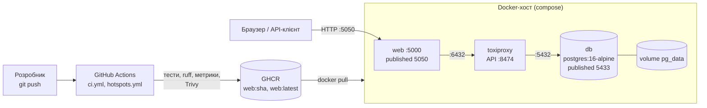
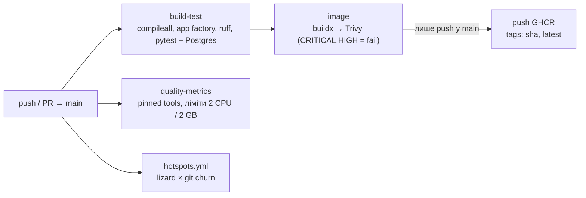

# ISD — специфікація інфраструктури «Wholesale»

> **Що це за документ.** ISD (Infrastructure Specification Document) описує, **де і на чому** працює система: середовища, контейнери, порядок запуску, змінні оточення, сховища, CI/CD, моніторинг, резервне копіювання і відновлення.
> Як система влаштована всередині, описано в [SDD](sdd.md), а чому прийнято такі рішення — в [ADR](architecture/adr/README.md).
> Цикл перегляду: **90 днів** (експлуатаційна документація), див. [maintenance.md](maintenance.md).

## 1. Топологія розгортання

| Профіль | Де працює | Як піднімається | Призначення |
|---|---|---|---|
| **local** | ноутбук розробника, venv + локальний PostgreSQL | `python app.py` (порт 5000) | розробка без Docker |
| **container** | Docker Compose: `db` → `toxiproxy` → `web` | `docker compose up -d --build` (порт 5050) | основний спосіб запуску, демо, Fault Injection |
| **ci** | GitHub Actions: `ubuntu-latest` + service-контейнер `postgres:16-alpine` | автоматично на push / PR у `main` | збірка, тести, метрики, образ |
| **production** (цільовий) | VM з Docker, образ `ghcr.io/nazarfrazovir/curs_project/web` | compose з `image:` замість `build:` | публікації в main; окремого прод-хосту поки немає |



## 2. Контейнери і порядок запуску

Порядок запуску задано через `depends_on` у `docker-compose.yml`: **`db` (healthy) → `toxiproxy` (started) → `web`**. `web` чекає **і** на `db: service_healthy` напряму, **і** на `toxiproxy: service_started`. Готовим `web` вважається, коли його healthcheck (`/api/health`) повертає 200.

### db
* Образ `postgres:16-alpine`, порт `5433:5432`, volume `pg_data:/var/lib/postgresql/data`.
* Тека `sql/` змонтована в `/docker-entrypoint-initdb.d`, тому міграції `00…09` виконуються **лише при першій ініціалізації порожнього volume**. Нову міграцію на наявній БД треба накочувати вручну: `docker compose exec -T db psql -U $POSTGRES_USER -d $POSTGRES_DB < sql/NN_name.sql`.
* Healthcheck: `pg_isready` кожні 5 с, 10 спроб.
* Компоненти SDD: [`db.py`](sdd.md#db), модель даних [SDD §4](sdd.md#4-модель-даних).

### toxiproxy
* Образ `ghcr.io/shopify/toxiproxy:2.9.0`, API `8474`, проксі `toxiproxy:6432 → db:5432` (конфіг `toxiproxy.json`).
* Стартує після того, як `db` стане healthy. Керування збоями: `./fault.sh timeout | reset | status`.
* Компоненти SDD: [`api.py`](sdd.md#api), [`resilience.py`](sdd.md#resilience).

### web
* Збирається з `Dockerfile` (`python:3.11-slim`, `pip install -r requirements.txt`), команда `python app.py`, порт `5050:5000`.
* `DATABASE_URL` вказує на **toxiproxy**, а не на `db` напряму.
* Healthcheck: `python -c urllib.request.urlopen('http://localhost:5000/api/health')` кожні 10 с, timeout 3 с, 5 спроб, `start_period` 10 с. Стан видно в `docker compose ps` (`healthy` / `unhealthy`).
* Компоненти SDD: [`app.py`](sdd.md#3-опис-компонентів), [`auth`](sdd.md#auth), [`inventory`](sdd.md#inventory), [`warehouse`](sdd.md#warehouse), [`reports`](sdd.md#reports), [`privacy`](sdd.md#privacy), [`dashboard`](sdd.md#dashboard), [`alerts`](sdd.md#alerts).

Допоміжні compose-файли:
* `docker-compose.quality.yml` — ізольоване вимірювання метрик і k6 з лімітами CPU/пам'яті (ЛР5);
* `docker-compose.sonar.yml` — **deprecated**: локальний SonarQube з ЛР1, замінений SonarCloud ([ADR-0004](architecture/adr/0004-sonarcloud-instead-of-local-sonarqube.md)).

## 3. Змінні оточення (без секретів)

Шаблон — `last – копія/.env.example`; файл `.env` у git не потрапляє.

| Змінна | Де використовується | dev (local) | test (CI) | production | Примітка |
|---|---|---|---|---|---|
| `POSTGRES_DB` | compose `db` | `wholesale_db` | `wholesale_test` | `wholesale_db` | |
| `POSTGRES_USER` | compose `db` | `postgres` | `postgres` | окремий користувач | |
| `POSTGRES_PASSWORD` | compose `db` | будь-який | не потрібен (`trust`) | **секрет** зі сховища секретів | |
| `DATABASE_URL` | `db.py` | `postgresql://…@localhost:5432/wholesale_db` | порожній → тести без БД | `postgresql://…@toxiproxy:6432/…` | без нього пул не створюється |
| `TEST_DATABASE_URL` | `tests/gdpr` | опційно | `postgresql://postgres@localhost:5432/wholesale_test` | — | інтеграційні тести privacy |
| `DB_CONNECT_TIMEOUT` | `db.py` | `2` | `2` | `2` | секунди |
| `DB_RETRY_ATTEMPTS` | `resilience.py` | `3` | `3` | `3` | |
| `DB_RETRY_BASE_DELAY` | `resilience.py` | `0.1` | `0.1` | `0.1` | секунди, експоненційний backoff |
| `DB_RETRY_MAX_DELAY` | `resilience.py` | `1.0` | `1.0` | `1.0` | секунди |
| `STOCK_ALERT_THRESHOLD` | `alerts.py` | `10` | `10` | за потребою бізнесу | поріг для `/api/stock-alerts` без параметра `below` |
| `SECRET_KEY` | `app.py` (сесії Flask) | будь-який | `dev_secret` за замовчуванням | **секрет** | |
| `FLASK_DEBUG` | `app.py` | `1` | — | **не задавати** | |
| `LOG_LEVEL` | `privacy/logging_setup.py` | `INFO` | `INFO` | `INFO` | |
| `LOG_FORMAT` | `privacy/logging_setup.py` | `text` | `text` | `json` | JSON-логи з маскуванням PII |
| `GITHUB_TOKEN` | `secrets_trap.py` (демо ЛР3) | — | видає Actions | — | лише для демо витоку секретів |

## 4. Сховища даних

| Сховище | Що зберігає | Збереження | Резервування |
|---|---|---|---|
| PostgreSQL 16, схема `app` | усі бізнес-дані й PII | Docker volume `pg_data` | щоденний `pg_dump` (§6) |
| Stale-кеш `/api/balance` | останні залишки в пам'яті процесу `web` | до перезапуску | не потрібне |
| GHCR | образи `web:<sha>`, `web:latest` | постійно | історія тегів = точки відкату |
| Артефакти CI | `pytest-report`, `quality-metrics` (90 днів за замовчуванням GitHub), `hotspots-report` (30 днів) | GitHub Actions | — |

## 5. CI/CD-конвеєр

**Тригери:** `ci.yml` — push і PR у `main` (новий push скасовує попередній запуск, `concurrency`); `hotspots.yml` — будь-який push/PR і `workflow_dispatch`.



| Стадія (job) | Що робить | Quality Gate (блокує) |
|---|---|---|
| `build-test` | `compileall`, збірка `create_app()`, `ruff check`, `pytest` (з Postgres) | помилка компіляції, порушення ruff, червоний тест |
| `quality-metrics` | text hygiene, `collect_metrics.py`, coverage, mutmut, `balanced_gate.py` | CCN > 10, Cognitive > 16; Balanced Gate (coverage **і** mutation score) |
| `image` | збірка образу, Trivy | вразливості CRITICAL/HIGH |
| публікація | push у `ghcr.io/…/web:<sha>` і `:latest` | лише після всіх попередніх |
| `hotspots` | матриця складність × мінливість | звіт-артефакт (не блокує) |
| локальні git-хуки (`githooks/`) | pre-commit: lizard CC ≤ 10 + gitleaks; post-commit: `scan.sh` (deprecated) | коміт блокується |
| аудит документації (ЛР10) | `python scripts/doc_audit.py --gate` | дрейф паспорта, прострочений перегляд |

**Реліз і відкат.**
1. Реліз: злиття PR у `main`, далі CI публікує `web:<sha>`. На хості: `docker compose pull web && docker compose up -d web`.
2. Відкат: у compose вказати попередній тег `web:<попередній sha>` (видно в GHCR або `git log`), потім `docker compose up -d web`. Схема БД зворотно сумісна, бо міграції лише додають колонки й таблиці (`ADD COLUMN IF NOT EXISTS`).

## 6. Моніторинг, резервне копіювання, RTO/RPO

**Моніторинг**
* `GET /api/balance`: поле `degraded` і `source` (`db` / `cache`) показують стан зв'язку з БД; 503 + `Retry-After` — БД недоступна і кешу немає.
* `GET /api/health`: 200 `{"status":"ok","db":"up"}` або 503. Використовується healthcheck-ом `web`; придатний для зовнішнього uptime-монітора.
* `GET /api/stock-alerts`: бізнес-моніторинг товарів, що закінчуються.
* Healthcheck `db` (`pg_isready`) і `docker compose ps`.
* Логи `web` (`docker compose logs web`): у production `LOG_FORMAT=json`, PII маскується (`privacy/logging_setup.py`), рядки `FALLBACK /api/balance` сигналізують про деградацію.

**Резервне копіювання**

```bash
# щоденно (cron 02:30), зберігаємо 14 останніх копій
docker compose exec -T db pg_dump -U "$POSTGRES_USER" -d "$POSTGRES_DB" -Fc > backups/wholesale_$(date +%F).dump
find backups -name 'wholesale_*.dump' -mtime +14 -delete
```

**Відновлення**

```bash
docker compose up -d db
docker compose exec -T db pg_restore -U "$POSTGRES_USER" -d "$POSTGRES_DB" --clean --if-exists < backups/wholesale_YYYY-MM-DD.dump
docker compose up -d toxiproxy web
```

| Показник | Цільове значення | Чим забезпечується |
|---|---|---|
| **RPO** (допустима втрата даних) | **≤ 24 год** | щоденний `pg_dump`; для RPO ≤ 15 хв потрібен WAL-архів (поза межами проєкту) |
| **RTO** (допустимий час відновлення) | **≤ 1 год** | готовий образ у GHCR, compose, скрипт відновлення вище; відкат коду — 5 хв (зміна тегу) |
