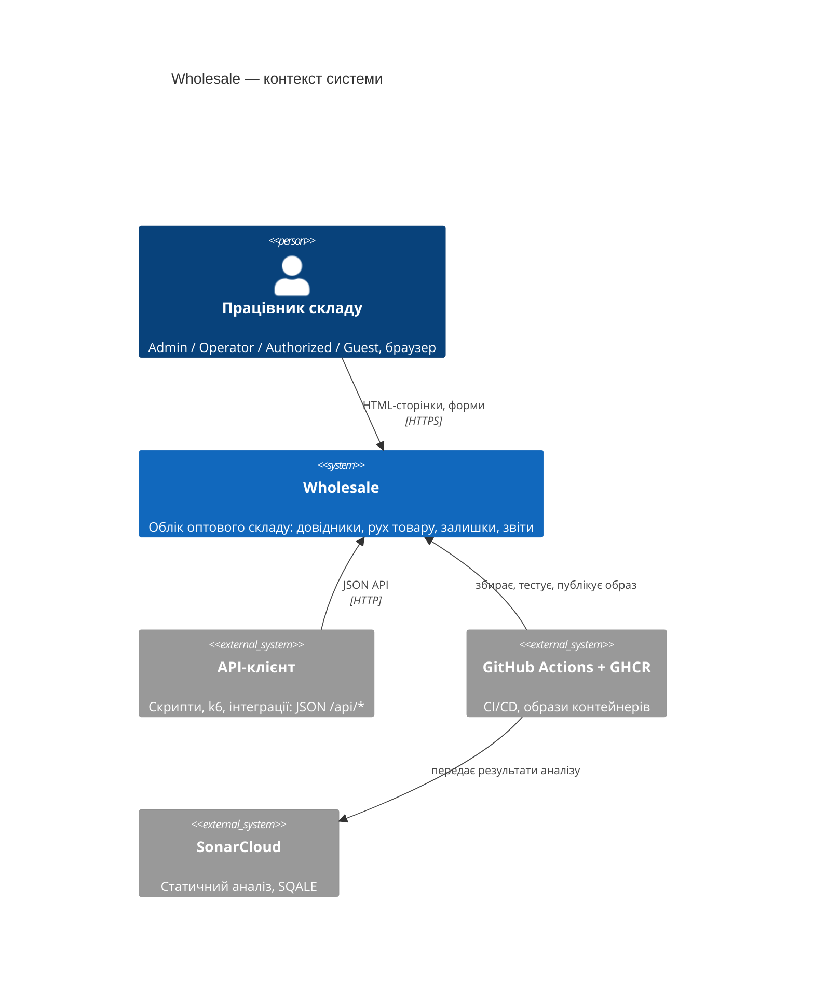
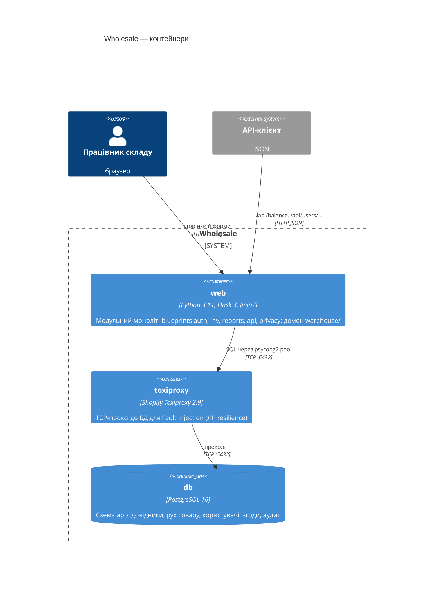
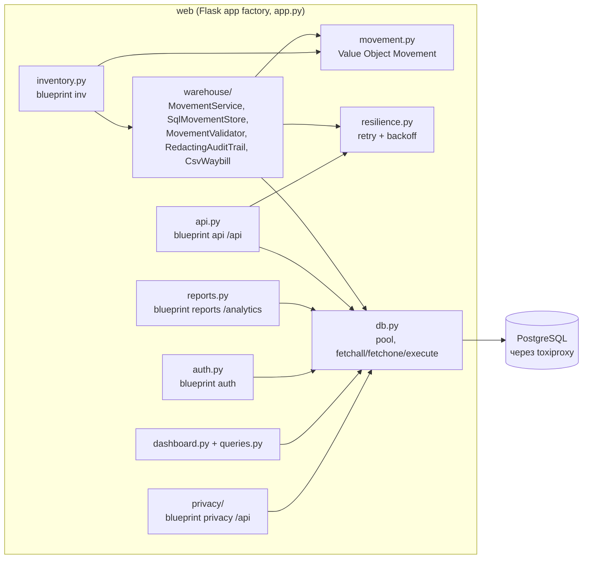
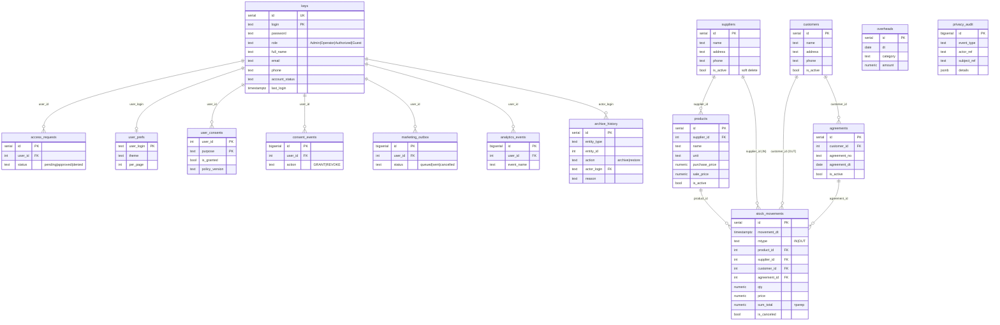

# SDD — документ проєктування системи «Wholesale»

> **Що це за документ.** SDD (System Design Document) описує, **як система влаштована всередині**: які є компоненти, хто з ким взаємодіє, які дані зберігаються, які контракти між частинами.
> Тут немає того, **де і на чому** вона працює: це описано в [ISD](isd.md). **Чому** обрано саме таке рішення, записано в [ADR](architecture/adr/README.md).
> Документ — частина архітектурного паспорта. Регламент його перегляду описано в [maintenance.md](maintenance.md).

## 1. Призначення і контекст

**Wholesale** — вебсистема обліку оптового складу. Вона веде довідники постачальників, клієнтів, товарів і договорів, журнал руху товару (надходження `IN` / відвантаження `OUT`), рахує залишки, формує аналітичні звіти й CSV-накладні. Окремий контур відповідає за захист персональних даних (GDPR, ЛР4).

**Користувачі** (ролі в таблиці `keys.role`):

| Роль | Що може |
|---|---|
| `Admin` | усе, плюс керування користувачами, заявками на доступ, відновлення з архіву, `uncancel` |
| `Operator` | додавання, редагування, архівування, скасування рухів |
| `Authorized` | перегляд, пошук, звіти |
| `Guest` | перегляд |

### 1.1 Контекстна діаграма (C4, рівень 1)

## 2. C4-діаграма контейнерів (рівень 2)

Розгортання кожного контейнера: [`web`](isd.md#web), [`toxiproxy`](isd.md#toxiproxy), [`db`](isd.md#db).

### 2.1 Компоненти контейнера `web` (C4, рівень 3)

## 3. Опис компонентів

Кожен компонент посилається на ті, з якими взаємодіє, і на свій опис розгортання в ISD.

| Компонент | Відповідальність | Ключові залежності | Взаємодіє з | Розгортання |
|---|---|---|---|---|
| **`app.py`** | App factory `create_app()`: реєструє blueprints, privacy-хуки, `teardown_appcontext` | Flask, python-dotenv | усі blueprints; [`privacy`](#privacy) | [ISD §2 `web`](isd.md#web) |
| **`auth.py`** (blueprint `auth`) | Вхід/вихід, профіль, зміна пароля, налаштування, адмінка користувачів, заявки на доступ | `db.py`, Werkzeug | [`db.py`](#db), [`inventory.py`](#inventory) (`require_role`) | [ISD `web`](isd.md#web) |
| **`inventory.py`** (blueprint `inv`) | Довідники (постачальники, клієнти, товари, договори), журнал рухів, архів, залишки, CSV | `warehouse`, `movement.py`, `db.py` | [`warehouse/`](#warehouse), [`db.py`](#db) | [ISD `web`](isd.md#web) |
| **`warehouse/`** | Домен руху товару (ЛР8): `MovementService` (оркестрація), `SqlMovementStore` (SQL), `MovementValidator` (правила складу), `RedactingAuditTrail` (аудит без PII), `CsvWaybill` + `CsvTable` (накладна). Контракти — `contracts.py` (`typing.Protocol`), збирання — `__init__.py` (Composition Root) | `db.py`, `resilience.py`, `privacy.sanitizer` | [`movement.py`](#movement), [`db.py`](#db), [`resilience.py`](#resilience) | [ISD `web`](isd.md#web) |
| **`movement.py`** | Value Object `Movement` (frozen dataclass): нормалізація форми, `as_db_row()` | — | [`warehouse/`](#warehouse), [`inventory.py`](#inventory) | — |
| **`reports.py`** (blueprint `reports`, `/analytics`) | 11 аналітичних звітів, SQL-консоль (лише SELECT), накладні витрати | `db.py` | [`db.py`](#db) | [ISD `web`](isd.md#web) |
| **`api.py`** (blueprint `api`, `/api`) | JSON-залишки `/api/balance` з Retry і Fallback на stale-кеш (graceful degradation) | `resilience.py`, `db.py` | [`resilience.py`](#resilience), [`db.py`](#db) | [ISD `web`](isd.md#web), [ISD `toxiproxy`](isd.md#toxiproxy) |
| **`privacy/`** (blueprint `privacy`, `/api`) | ЛР4: безпечне логування (маскування PII), експорт персональних даних, анонімізація, згоди (Consent Policy Gate), аудит | `db.py`, logging | [`db.py`](#db); описано детально в [`PRIVACY.md`](../last%20–%20копія/PRIVACY.md) | [ISD `web`](isd.md#web), [ISD §3 змінні `LOG_*`](isd.md#3-змінні-оточення-без-секретів) |
| **`dashboard.py`, `queries.py`** | Головна сторінка `/`: KPI, останні рухи; глобальні змінні шаблонів | `db.py` | [`db.py`](#db) | [ISD `web`](isd.md#web) |
| **`resilience.py`** | `call_with_retry`: експоненційний backoff, `TRANSIENT_ERRORS` | змінні `DB_RETRY_*` | [`api.py`](#api), [`warehouse/`](#warehouse) | [ISD §3](isd.md#3-змінні-оточення-без-секретів) |
| **`db.py`** | Пул з'єднань psycopg2 (`SimpleConnectionPool` 1..10), `get_conn()`, хелпери `fetchall/fetchone/execute` | `DATABASE_URL`, `DB_CONNECT_TIMEOUT` | контейнер [`db`](#2-c4-діаграма-контейнерів-рівень-2) через [`toxiproxy`](isd.md#toxiproxy) | [ISD `db`](isd.md#db) |
| **`templates/`, `static/`** | Jinja2-шаблони, JS (командна палітра, гарячі клавіші, таблиці) | — | усі HTML-маршрути | [ISD `web`](isd.md#web) |
| **`scripts/`** | Інженерні утиліти якості: метрики (ЛР5–8), Software Economics (ЛР9), аудит документації (ЛР10) | lizard, radon, git | CI ([ISD §5](isd.md#5-cicd-конвеєр)) | [ISD §5](isd.md#5-cicd-конвеєр) |

## 4. Модель даних

Схема PostgreSQL `app` будується послідовністю міграцій `sql/00…09` (номера `08` немає). Бізнес-інваріанти, що їх перевіряє сама БД:

* тригер `trg_set_sum_total`: `sum_total = qty × price`;
* тригер `check_stock_nonnegative`: забороняє `OUT`, якщо не вистачає залишку;
* представлення `stock_balance`: залишок = Σ`IN` − Σ`OUT` без скасованих рухів.

| Об'єкт БД | Міграція | Призначення |
|---|---|---|
| `keys` | 00, 06, 07, 09 | користувачі, ролі, PII (ЛР4) |
| `suppliers`, `customers`, `products`, `agreements` | 00, 02 | довідники з м'яким видаленням (`is_active`, `archived_*`) |
| `stock_movements` | 00, 03 | журнал руху товару; скасування замість видалення |
| `archive_history` | 02 | хто, коли і чому архівував чи відновлював запис |
| `stock_balance` (VIEW) | 04 | залишки; джерело для `/balance` і `/api/balance` |
| `overheads` | 05 | накладні витрати для звіту рентабельності |
| `access_requests` | 06 | заявки на роль `Authorized` |
| `user_prefs`, `user_consents`, `consent_events`, `marketing_outbox`, `analytics_events`, `privacy_audit` | 09 | Privacy Engineering (див. `PRIVACY.md`) |

## 5. Контракти між компонентами

### 5.1 Внутрішні програмні контракти

| Контракт | Постачальник → споживач | Сигнатура |
|---|---|---|
| Пул БД | `db.py` → усі | `get_conn()` (context manager), `fetchall(q, p)`, `fetchone(q, p)`, `execute(q, p)` |
| Retry | `resilience.py` → `api.py`, `warehouse/store.py` | `call_with_retry(func, attempts=None, sleep=None)`; після вичерпання спроб кидає `TRANSIENT_ERRORS` (`OperationalError`, `InterfaceError`) |
| `StockReader` | `SqlMovementStore` → `MovementValidator` | `available_qty(product_id, exclude_id=None)` |
| `MovementRepository` | `SqlMovementStore` → `MovementService` | `edit_error(rid)`, `insert(movement)`, `update(rid, movement)` |
| `MovementSource` | `SqlMovementStore` → `CsvWaybill` | `find(rid) -> Movement \| None` |
| `MovementRules` | `MovementValidator` → `MovementService` | `check(movement, exclude_id=None) -> str \| None` |
| `AuditSink` | `RedactingAuditTrail` → `MovementService` | `record(action, movement, actor, rid=None)` |
| `TableFormat` | `CsvTable` → `CsvWaybill` | `render(header, rows) -> bytes` |
| Ролі | `inventory.require_role(*roles)` → маршрути | `True`, якщо роль сесії входить у перелік |
| Privacy | `privacy.init_app(app)` → `app.py` | хуки `before_request` / `after_request` / `teardown_request`, реєстрація blueprint `privacy`; `configure_logging()` |

### 5.2 HTTP-контракти (повний перелік маршрутів)

Перелік звіряється з кодом автоматично: `python scripts/doc_audit.py` повідомляє про маршрути, яких тут немає.

#### inv — довідники, рух товару, залишки

Доступ: читання — будь-яка роль; зміни — Admin/Operator; `restore`, `uncancel` — Admin.

| Метод | Маршрут | Обробник | Відповідь |
|---|---|---|---|
| GET | `/suppliers` | `suppliers_list` | HTML |
| POST | `/suppliers/add` | `suppliers_add` | redirect + flash |
| POST | `/suppliers/<int:rid>/archive` | `suppliers_archive` | redirect + flash |
| POST | `/suppliers/<int:rid>/restore` | `suppliers_restore` | redirect + flash |
| GET | `/customers` | `customers_list` | HTML |
| POST | `/customers/add` | `customers_add` | redirect + flash |
| POST | `/customers/<int:rid>/archive` | `customers_archive` | redirect + flash |
| POST | `/customers/<int:rid>/restore` | `customers_restore` | redirect + flash |
| GET | `/products` | `products_list` | HTML |
| POST | `/products/add` | `products_add` | redirect + flash |
| POST | `/products/<int:rid>/archive` | `products_archive` | redirect + flash |
| POST | `/products/<int:rid>/restore` | `products_restore` | redirect + flash |
| GET | `/agreements` | `agreements_list` | HTML |
| POST | `/agreements/add` | `agreements_add` | redirect + flash |
| POST | `/agreements/<int:rid>/archive` | `agreements_archive` | redirect + flash |
| POST | `/agreements/<int:rid>/restore` | `agreements_restore` | redirect + flash |
| GET | `/movements` | `movements_list` | HTML |
| POST | `/movements/add` | `movements_add` | redirect + flash |
| GET | `/movements/<int:rid>/waybill.csv` | `movements_waybill` | CSV |
| POST | `/movements/<int:rid>/cancel` | `movements_cancel` | redirect + flash |
| POST | `/movements/<int:rid>/uncancel` | `movements_uncancel` | redirect + flash |
| GET | `/archive-history` | `archive_history_page` | HTML |
| GET | `/suppliers/<int:rid>/edit` | `suppliers_edit` | HTML |
| POST | `/suppliers/<int:rid>/update` | `suppliers_update` | redirect + flash |
| GET | `/customers/<int:rid>/edit` | `customers_edit` | HTML |
| POST | `/customers/<int:rid>/update` | `customers_update` | redirect + flash |
| GET | `/products/<int:rid>/edit` | `products_edit` | HTML |
| POST | `/products/<int:rid>/update` | `products_update` | redirect + flash |
| GET | `/agreements/<int:rid>/edit` | `agreements_edit` | HTML |
| POST | `/agreements/<int:rid>/update` | `agreements_update` | redirect + flash |
| GET | `/movements/<int:rid>/edit` | `movements_edit` | HTML |
| POST | `/movements/<int:rid>/update` | `movements_update` | redirect + flash |
| GET | `/balance` | `balance_page` | HTML |
| GET | `/balance.csv` | `balance_csv` | CSV |

#### auth — автентифікація і адміністрування

Доступ: `/admin/*` — лише Admin; решта — автентифікований користувач.

| Метод | Маршрут | Обробник | Відповідь |
|---|---|---|---|
| GET | `/login` | `login_get` | HTML |
| POST | `/login` | `login_post` | redirect + flash |
| GET | `/logout` | `logout` | HTML |
| GET | `/admin/users` | `users_list` | HTML |
| POST | `/admin/users/add` | `users_add` | redirect + flash |
| GET | `/admin/users/<int:rid>/edit` | `users_edit` | HTML |
| POST | `/admin/users/<int:rid>/update` | `users_update` | redirect + flash |
| GET/POST | `/forgot` | `forgot` | HTML |
| GET | `/request-access` | `request_access_get` | HTML |
| POST | `/request-access` | `request_access_post` | redirect + flash |
| GET | `/admin/access-requests` | `requests_list` | HTML |
| POST | `/admin/access-requests/<int:rid>/approve` | `requests_approve` | redirect + flash |
| POST | `/admin/access-requests/<int:rid>/deny` | `requests_deny` | redirect + flash |
| GET | `/profile` | `profile_get` | HTML |
| POST | `/profile/change-password` | `profile_change_password` | redirect + flash |
| GET | `/settings` | `settings_get` | HTML |
| POST | `/settings` | `settings_post` | redirect + flash |

#### reports — аналітика (`/analytics`)

Доступ: звіти — без окремої перевірки ролі (видно всім, хто має доступ до інтерфейсу); SQL-консоль і накладні витрати — Admin/Operator. Зверніть увагу: маршрути витрат мають подвоєний префікс `/analytics/analytics/...` — так зареєстровано в коді.

| Метод | Маршрут | Обробник | Відповідь |
|---|---|---|---|
| GET | `/analytics/` | `index` | HTML |
| GET | `/analytics/top-customers` | `top_customers` | HTML |
| GET | `/analytics/product-prices` | `product_prices` | HTML |
| GET | `/analytics/customers-of-product` | `customers_of_product` | HTML |
| GET | `/analytics/supplies-by-supplier` | `supplies_by_supplier` | HTML |
| GET | `/analytics/by-agreement` | `by_agreement` | HTML |
| GET | `/analytics/sales_of_product` | `sales_of_product` | HTML |
| GET | `/analytics/profitability` | `profitability` | HTML |
| GET | `/analytics/supplier-nomenclature` | `supplier_nomenclature` | HTML |
| GET | `/analytics/customers-threshold` | `customers_threshold` | HTML |
| GET | `/analytics/suppliers-threshold` | `suppliers_threshold` | HTML |
| GET | `/analytics/sql` | `sql_console` | HTML |
| POST | `/analytics/analytics/overheads/add` | `overheads_add` | redirect + flash |
| POST | `/analytics/analytics/overheads/<int:rid>/delete` | `overheads_delete` | redirect + flash |

#### api — JSON API (`/api`)

Доступ: без сесії (публічний JSON).

| Метод | Маршрут | Обробник | Відповідь |
|---|---|---|---|
| GET | `/api/balance` | `balance` | JSON |

#### privacy — персональні дані і згоди (`/api`)

Доступ: суб'єкт даних або Admin (`may_act_on`); дії журналюються в `privacy_audit`.

| Метод | Маршрут | Обробник | Відповідь |
|---|---|---|---|
| GET | `/api/me` | `me` | JSON |
| GET | `/api/users/<int:user_id>/personal-data` | `personal_data` | JSON |
| POST | `/api/users/<int:user_id>/anonymize` | `anonymize` | JSON |
| GET | `/api/privacy/erasure-policy` | `erasure_policy` | JSON |
| GET | `/api/users/<int:user_id>/consents` | `list_consents` | JSON |
| POST | `/api/users/<int:user_id>/consents/<purpose>/grant` | `grant_consent` | JSON |
| POST | `/api/users/<int:user_id>/consents/<purpose>/revoke` | `revoke_consent` | JSON |
| POST | `/api/users/<int:user_id>/marketing-email` | `marketing_email` | JSON |
| POST | `/api/users/<int:user_id>/analytics-events` | `analytics_event` | JSON |
| POST | `/api/marketing/dispatch` | `marketing_dispatch` | JSON |

Головна сторінка: `GET` `/` → `dashboard.dashboard` (HTML), зареєстрована через `app.add_url_rule`.

**JSON-контракт `/api/balance`** (для QA):

| Стан | HTTP | Тіло |
|---|---|---|
| БД доступна | 200 | `{"status":"ok","degraded":false,"source":"db","items":[{product_id, product, unit, supplier, balance_qty}]}` |
| БД недоступна, є кеш | 200 + `Warning: 110` | `{"status":"degraded","degraded":true,"source":"cache","cache_age_s":N,"items":[…]}` |
| БД недоступна, кешу немає | 503 + `Retry-After: 5` | `{"status":"unavailable","degraded":true,"items":[]}` |

Поведінкові контракти для QA закріплені тестами: `tests/test_resilience_contract.py` (API), `tests/test_movements_flow.py` (рух товару), `tests/test_warehouse_components.py` (контракти `Protocol`), `tests/gdpr/` (privacy).
