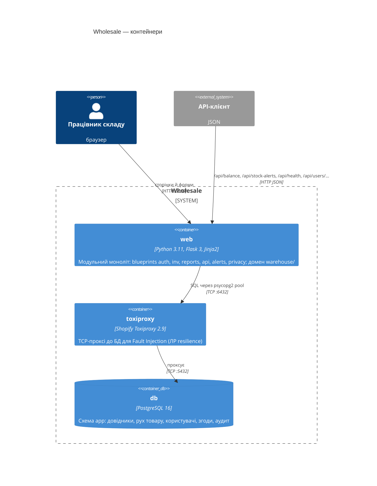

# Лабораторна робота №10
## Інженерний аудит програмної документації, архітектурний паспорт системи (SDD, ISD, ADR) та супровід знань (Handover)

**Об'єкт:** Curs_Project / Wholesale — вебсистема обліку оптового складу (Flask + PostgreSQL), яка розвивалась протягом ЛР1–9.
**Гілка:** `lab10-documentation` (від `43027ae`, кінець ЛР9)
**Інструменти:** Git CLI, VS Code (Markdown), Mermaid.js, власний аудитор `scripts/doc_audit.py`

| Коміт | Повідомлення | Завдання |
|---|---|---|
| `1cccb45` | `chore(docs-audit): inventory registry and Git-based documentation currency audit` | 1 |
| `a9ff8bb` | `docs(architecture): deliver design and infrastructure passport` | 2 |
| `f0d7a88` | `docs(audit): simulate documentation decay, FAIL` | 3 (краш-тест) |
| `49694ff` | `docs(maintenance): restore documentation currency, PASS` | 3 (відновлення) |
| `3a9748a` | `docs(handover): handover package, Bus Factor declaration, docs-currency CI gate` | 3 (handover) |

---

## Завдання 1. Інвентаризаційний аудит документації

### 1.1 Інвентаризаційний реєстр

Повний машиночитний реєстр лежить у `docs/registry.json`: 19 носіїв знань на момент аудиту, 27 після ЛР10. Нижче наведено стан **до** ЛР10.

**Класифікація за двома осями** (Лекція 8):
* **продукт** — «жива» документація, що еволюціонує разом із системою; **процес** — історичний запис, що фіксує факт у часі (звіт, протокол, повідомлення коміту);
* **технічна** — що система робить; **архітектурна** — як вона влаштована; **експлуатаційна** — як запускається, налаштовується, супроводжується.

| # | Документ | Розташування | Тип | Категорія | Аудиторії | Власник | Не покриває потреб |
|---|---|---|---|---|---|---|---|
| 1 | README застосунку | `last – копія/README.md` | продукт | експлуатаційна | новачок, розробники, DevOps | NazarFrazovir (El) | бізнес (призначення системи), DevOps (Docker, CI), QA (як запускати тести) |
| 2 | Технічна документація Privacy Engineering (ЛР4) | `last – копія/PRIVACY.md` | продукт | архітектурна + технічна | розробники, QA, бізнес (DPO) | NazarFrazovir (El) | DevOps (як вмикати маскування логів у проді) |
| 3 | Звіт ЛР5 (measurement governance) | `last – копія/LR5_report.md` | процес | технічна | QA, викладач | NazarFrazovir (El) | — |
| 4 | Протокол експериментів ЛР5 | `last – копія/experiments/lab5/README.md` | процес | технічна | QA | NazarFrazovir (El) | — |
| 5 | Фрагменти для live-демо pre-commit (ЛР6) | `last – копія/experiments/lab6/README.md` | процес | експлуатаційна | розробники | NazarFrazovir (El) | — |
| 6 | Звіт ЛР9 | `last – копія/experiments/lab9/LR9_report.md` | процес | технічна | бізнес, викладач | NazarFrazovir (El) | — |
| 7 | Згенерований фінансовий леджер (ЛР9) | `last – копія/FINANCIAL_LEDGER.md` | процес | технічна | бізнес | scripts/software_economics.py (генерується) | — |
| 8 | Шаблон змінних оточення | `last – копія/.env.example` | продукт | експлуатаційна | DevOps, новачок | NazarFrazovir (El) | немає DATABASE_URL, DB_RETRY_*, LOG_*; зламаний останній рядок |
| 9 | Опис розгортання (коментарі compose) | `last – копія/docker-compose.yml` | продукт | експлуатаційна | DevOps | NazarFrazovir (El) | RTO/RPO, резервне копіювання |
| 10 | Локальний SonarQube (ЛР1) | `last – копія/docker-compose.sonar.yml` | продукт | експлуатаційна | QA | NazarFrazovir (El) | — |
| 11 | CI-конвеєр (коментарі в YAML) | `.github/workflows/ci.yml` | продукт | експлуатаційна | DevOps, QA | NazarFrazovir (El) | немає опису стадій поза YAML |
| 12 | Інструкція встановлення git-хуків | `githooks/install.sh` | продукт | експлуатаційна | розробники | NazarFrazovir (El) | не згадано в README |
| 13 | Схема БД (коментарі SQL) | `last – копія/sql/00_schema.sql` | продукт | архітектурна | розробники | NazarFrazovir (El) | немає ER-моделі всіх 9 міграцій |
| 14 | Конфіг Sonar-сканера | `last – копія/sonar-project.properties` | продукт | експлуатаційна | QA | NazarFrazovir (El) | python 3.13 при фактичному 3.11 |
| 15 | app.py у корені репозиторію (1 рядок `import os`) | `app.py` | продукт | технічна | розробники | — | вводить в оману: справжній app.py у `last – копія/` |
| 16 | Коментарі в коді | `docstrings і коментарі в *.py` | продукт | технічна | розробники | автор модуля | немає карти системи |
| 17 | Повідомлення комітів | `git log (56+ повідомлень комітів)` | процес | технічна | розробники | автор коміту | — |
| 18 | Описи PR (трекер) | `GitHub Pull Requests #1–#4` | процес | технічна | розробники, QA | NazarFrazovir (El) | — |
| 19 | Звіти лабораторних 6–8 | `звіти ЛР6–ЛР8 і пояснення (поза репозиторієм)` | процес | технічна | викладач | NazarFrazovir (El) | відсутні в репозиторії |

### 1.2 Лог метрик актуальності (Git CLI)

Команди і їхній сирий вивід (`docs/audit/2026-11-23-git-cli.log`):

```text
$ git log -1 --format=%cs -- <документ>
2025-11-18  last – копія/README.md
2026-10-19  last – копія/PRIVACY.md
2026-11-02  last – копія/LR5_report.md
2026-11-01  last – копія/experiments/lab5/README.md
2026-11-08  last – копія/experiments/lab6/README.md
2026-10-12  last – копія/.env.example
2026-10-05  last – копія/docker-compose.yml
2026-10-04  last – копія/docker-compose.sonar.yml
2026-11-08  .github/workflows/ci.yml
2026-11-08  githooks/install.sh
2025-11-18  last – копія/sql/00_schema.sql
2026-10-04  last – копія/sonar-project.properties
2026-10-12  app.py

$ git log --oneline -- <компонент> | wc -l      # Code-Doc Change Ratio
  10  last – копія/inventory.py
   2  last – копія/auth.py
   6  last – копія/reports.py
   2  last – копія/api.py
   6  last – копія/db.py
   2  last – копія/movement.py
   4  last – копія/privacy
   4  last – копія/warehouse
   4  last – копія/sql
   9  last – копія/scripts
   3  last – копія/docker-compose.yml
   1  last – копія/README.md (документ)
   1  last – копія/PRIVACY.md (документ)

$ git log --oneline $(git log -1 --format=%H -- "last – копія/README.md")..HEAD -- "last – копія" ":(exclude)*.md" | wc -l
43

$ git shortlog -sn --no-merges HEAD
    30	NazarFrazovir
    21	nazar
```

Ті самі метрики для кожного документа автоматично рахує `scripts/doc_audit.py`:

| Метрика | Команда Git, яку виконує скрипт |
|---|---|
| Last Updated Age | `git log -1 --format=%H %cs -- <документ>` → днів до дати аудиту |
| Code-Doc Change Ratio | `git log --oneline -- <покритий код>` проти `git log --oneline -- <документ>` |
| Змін коду після документа | `git log --oneline <останній коміт документа>..HEAD -- <покритий код>` |
| Access Evidence | `git grep -l -F <шлях документа>` (посилання з інших файлів) + ручна примітка про споживача |

```bash
cd "last – копія"
python scripts/doc_audit.py --today 2026-11-23 --md ../docs/audit/2026-11-23-baseline.md
```

Результат baseline (`docs/audit/2026-11-23-baseline.md`, файлові документи):

| Документ | Тип | Оновлено | Вік, дн. | Комітів doc | Комітів коду | Код після doc | Посилань | Сигнали |
|---|---|---|---:|---:|---:|---:|---:|---|
| `last – копія/README.md` | product | 2025-11-18 | 370 | 1 | 40 | 39 | 0 | ймовірно застарілий (>180 дн.); прострочено перегляд (90 дн.); структурний дрейф: 39 змін коду без оновлення |
| `last – копія/PRIVACY.md` | product | 2026-10-19 | 35 | 1 | 4 | 3 | 0 | відстає від коду на 3 коміт(и) |
| `last – копія/LR5_report.md` | process | 2026-11-02 | 21 | 1 | 4 | 2 | 0 | OK |
| `last – копія/experiments/lab5/README.md` | process | 2026-11-01 | 22 | 1 | 2 | 1 | 0 | OK |
| `last – копія/experiments/lab6/README.md` | process | 2026-11-08 | 15 | 1 | 10 | 4 | 0 | без споживача (Dead Documentation?) |
| `last – копія/experiments/lab9/LR9_report.md` | process | 2026-11-22 | 1 | 1 | 1 | 0 | 1 | OK |
| `last – копія/FINANCIAL_LEDGER.md` | process | 2026-11-22 | 1 | 1 | 1 | 0 | 4 | OK |
| `last – копія/.env.example` | product | 2026-10-12 | 42 | 2 | 10 | 3 | 1 | відстає від коду на 3 коміт(и) |
| `last – копія/docker-compose.yml` | product | 2026-10-05 | 49 | 3 | 3 | 1 | 0 | відстає від коду на 1 коміт(и) |
| `last – копія/docker-compose.sonar.yml` | product | 2026-10-04 | 50 | 2 | 3 | 1 | 1 | відстає від коду на 1 коміт(и) |
| `.github/workflows/ci.yml` | product | 2026-11-08 | 15 | 5 | 9 | 4 | 2 | відстає від коду на 4 коміт(и) |
| `githooks/install.sh` | product | 2026-11-08 | 15 | 1 | 3 | 0 | 0 | OK |
| `last – копія/sql/00_schema.sql` | product | 2025-11-18 | 370 | 1 | 4 | 3 | 0 | ймовірно застарілий (>180 дн.); прострочено перегляд (180 дн.); відстає від коду на 3 коміт(и) |
| `last – копія/sonar-project.properties` | product | 2026-10-04 | 50 | 2 | 2 | 1 | 0 | відстає від коду на 1 коміт(и); без споживача (Dead Documentation?) |
| `app.py` | product | 2026-10-12 | 42 | 1 | 0 | 0 | 0 | без споживача (Dead Documentation?) |

**Структурний дрейф:**

- SDD: маршрути без опису: **77**: `/`, `/admin/access-requests`, `/admin/access-requests/<int:rid>/approve`, `/admin/access-requests/<int:rid>/deny`, `/admin/users`, `/admin/users/<int:rid>/edit`, `/admin/users/<int:rid>/update`, `/admin/users/add`, `/agreements`, `/agreements/<int:rid>/archive`, `/agreements/<int:rid>/edit`, `/agreements/<int:rid>/restore` … (+65)
- SDD: таблиці без опису: **16**: `access_requests`, `agreements`, `analytics_events`, `archive_history`, `consent_events`, `customers`, `keys`, `marketing_outbox`, `overheads`, `privacy_audit`, `products`, `stock_balance` … (+4)
- README: публічні /api маршрути без опису: **11**: `/api/balance`, `/api/marketing/dispatch`, `/api/me`, `/api/privacy/erasure-policy`, `/api/users/<int:user_id>/analytics-events`, `/api/users/<int:user_id>/anonymize`, `/api/users/<int:user_id>/consents`, `/api/users/<int:user_id>/consents/<purpose>/grant`, `/api/users/<int:user_id>/consents/<purpose>/revoke`, `/api/users/<int:user_id>/marketing-email`, `/api/users/<int:user_id>/personal-data`
- ISD: сервіси compose без опису: **3**: `db`, `toxiproxy`, `web`
- ISD: змінні оточення без опису: **12**: `DATABASE_URL`, `DB_CONNECT_TIMEOUT`, `DB_RETRY_ATTEMPTS`, `DB_RETRY_BASE_DELAY`, `DB_RETRY_MAX_DELAY`, `FLASK_DEBUG`, `LOG_FORMAT`, `LOG_LEVEL`, `POSTGRES_DB`, `POSTGRES_PASSWORD`, `POSTGRES_USER`, `SECRET_KEY`

**Вердикт:** **FAIL — Documentation Decay**

- SDD: маршрути без опису: 77
- SDD: таблиці без опису: 16
- README: публічні /api маршрути без опису: 11
- ISD: сервіси compose без опису: 3
- ISD: змінні оточення без опису: 12

### 1.3 Діагноз антипатернів

**Documentation Decay** — документ описує вже неіснуючу систему:

| Документ | Доказ (Git CLI + зміст) |
|---|---|
| `last – копія/README.md` | вік **370 днів** (останній коміт 2025-11-18, єдиний за всю історію); **39 змін коду** застосунку без оновлення (> 20 — структурний дрейф; разом із тестами й експериментами — 43). Зміст: «виконай 4 SQL-файли», хоча міграцій 9; немає Docker, хоча основний спосіб запуску — `docker compose`; велить заповнити `DATABASE_URL` у `.env`, але в `.env.example` такої змінної немає; не описано жодного з 11 `/api/*` маршрутів |
| `last – копія/.env.example` | відстає на 3 коміти коду; немає `DATABASE_URL`, `DB_RETRY_*`, `LOG_*`; останній рядок злипся: `SECRET_KEY=your_secret_key_hereGITHUB_TOKEN=` — після копіювання в `.env` ключ сесії стає зіпсованим |
| `last – копія/sql/00_schema.sql` (як опис моделі) | 370 днів; модель даних розійшлася з реальною: ще 8 міграцій додали 10 таблиць і представлення |
| `last – копія/sonar-project.properties` | `sonar.python.version=3.13`, хоча фактично система працює на Python 3.11 (`Dockerfile`, CI) |
| `last – копія/PRIVACY.md` | відстає на 3 коміти `privacy/`: потрібен перегляд; після аналізу змін поведінка не змінилась |
| `last – копія/setup_db.py` | дублює DDL `user_prefs` з **іншими** значеннями за замовчуванням (`theme` light проти dark, `per_page` 10 проти 20), ніж актуальна міграція `09_privacy.sql` |

**Dead Documentation** — документ існує, але не має споживача:

| Документ | Доказ |
|---|---|
| `last – копія/experiments/lab6/README.md` | 0 вхідних посилань; демо ЛР6 завершено; `inventory.py`, до якого він додає код, змінився 4 рази після нього |
| `last – копія/docker-compose.sonar.yml`, `scan.sh`, `sonar-project.properties` | локальний SonarQube з ЛР1 замінено на SonarCloud (ЛР5); сервер ніхто не піднімає; post-commit хук викликає `scan.sh`, який без сервера завершується помилкою |
| `app.py` у **корені** репозиторію | один рядок `import os`; не використовується, вводить в оману (справжній `app.py` у `last – копія/`) |
| звіти ЛР6–ЛР8 | існують лише поза репозиторієм; для команди їх фактично немає |

Що виявилось **поза документами**: у репозиторії не було кореневого README (GitHub показував порожню сторінку), не було жодного опису архітектури, розгортання, бекапів і жодного зафіксованого рішення.

### 1.4 Матриця вердиктів

| Документ | Антипатерн | Проблема / непокриті потреби | Вердикт | Виконано в ЛР10 |
|---|---|---|---|---|
| `last – копія/README.md` | Decay | бізнес (призначення системи), DevOps (Docker, CI), QA (як запускати тести) | **оновити** | виконано: переписано (призначення, Docker, міграції, тести, API, онбординг) |
| `last – копія/PRIVACY.md` | ризик Decay (відстає) | DevOps (як вмикати маскування логів у проді) | **оновити (перегляд), залишити** | виконано: переглянуто 2026-11-23, додано примітку перегляду |
| `last – копія/LR5_report.md` | — | — | **залишити як історичний (archive)** | — |
| `last – копія/experiments/lab5/README.md` | — | — | **залишити як історичний** | — |
| `last – копія/experiments/lab6/README.md` | Dead | — | **deprecated (демо завершено, inventory.py змінився)** | виконано: позначено DEPRECATED у файлі |
| `last – копія/experiments/lab9/LR9_report.md` | — | — | **залишити як історичний** | — |
| `last – копія/FINANCIAL_LEDGER.md` | — | — | **залишити (генерований артефакт)** | — |
| `last – копія/.env.example` | Decay | немає DATABASE_URL, DB_RETRY_*, LOG_*; зламаний останній рядок | **оновити** | виконано: повний шаблон з усіма змінними, виправлено злиплий рядок |
| `last – копія/docker-compose.yml` | — | RTO/RPO, резервне копіювання | **залишити, описати в ISD** | виконано: описано в ISD §2 |
| `last – копія/docker-compose.sonar.yml` | Dead | — | **deprecated (замінено SonarCloud у CI)** | виконано: DEPRECATED (ADR-0004) |
| `.github/workflows/ci.yml` | — | немає опису стадій поза YAML | **залишити, описати в ISD** | виконано: описано в ISD §5 |
| `githooks/install.sh` | — | не згадано в README | **оновити посилання в README** | виконано: посилання в README |
| `last – копія/sql/00_schema.sql` | Decay (як опис моделі) | немає ER-моделі всіх 9 міграцій | **описати модель у SDD** | виконано: модель даних описано в SDD §4 |
| `last – копія/sonar-project.properties` | Decay + Dead | python 3.13 при фактичному 3.11 | **оновити** | виконано: python 3.11; файл лишається для scan.sh (deprecated) |
| `app.py` | Dead | вводить в оману: справжній app.py у `last – копія/` | **видалити** | виконано: видалено |
| `docstrings і коментарі в *.py` | — | немає карти системи | **залишити** | — |
| `git log (56+ повідомлень комітів)` | — | — | **залишити** | — |
| `GitHub Pull Requests #1–#4` | — | — | **залишити** | — |
| `звіти ЛР6–ЛР8 і пояснення (поза репозиторієм)` | Dead (для команди) | відсутні в репозиторії | **перенести в experiments/ або архів** | — |
| `last – копія/setup_db.py` | Decay + Dead | дублює DDL з sql/09_privacy.sql з іншими значеннями за замовчуванням (theme light/dark, per_page 10/20) | **видалити** | виконано: видалено (DDL живе в sql/09_privacy.sql) |

---

## Завдання 2. Архітектурний паспорт системи

Склад паспорта (`docs/`): **SDD** — як влаштовано, **ISD** — де і на чому працює, **ADR** — чому так. Кожен компонент SDD посилається на свій опис розгортання в ISD, і навпаки.

### 2.1 SDD (`docs/sdd.md`)

Структура: 1) призначення, ролі, контекстна C4-діаграма; 2) C4-діаграма контейнерів і компонентів `web`; 3) таблиця 14 компонентів (відповідальність, залежності, «взаємодіє з», посилання на ISD); 4) модель даних — ER-діаграма 16 об'єктів БД, інваріанти, таблиця міграцій; 5) контракти: 10 внутрішніх (`Protocol`, пул БД, retry, ролі) і повний перелік **79 HTTP-маршрутів** (76 унікальних шляхів), JSON-контракти `/api/balance`, `/api/stock-alerts`, `/api/health`.

**C4-діаграма контейнерів (Mermaid):**



**Фрагмент моделі даних і опис компонентів** — див. `docs/sdd.md` §3–4 (ER-діаграма Mermaid `erDiagram`).

### 2.2 ISD (`docs/isd.md`)

Структура: 1) топологія local / container / ci / production з діаграмою; 2) контейнери `db`, `toxiproxy`, `web` і порядок запуску; 3) **15 змінних оточення** по середовищах dev / test / production (без секретів); 4) сховища; 5) CI/CD: тригери, 5 job-ів, Quality Gates, реліз і відкат; 6) моніторинг, бекап `pg_dump`, відновлення `pg_restore`, **RTO / RPO**.

**Фрагмент ISD §6 — резервне копіювання і RTO/RPO:**

```bash
# щоденно (cron 02:30), зберігаємо 14 останніх копій
docker compose exec -T db pg_dump -U "$POSTGRES_USER" -d "$POSTGRES_DB" -Fc > backups/wholesale_$(date +%F).dump
find backups -name 'wholesale_*.dump' -mtime +14 -delete
```

**Відновлення**

```bash
docker compose up -d db
docker compose exec -T db pg_restore -U "$POSTGRES_USER" -d "$POSTGRES_DB" --clean --if-exists < backups/wholesale_YYYY-MM-DD.dump
docker compose up -d toxiproxy web
```

| Показник | Цільове значення | Чим забезпечується |
|---|---|---|
| **RPO** (допустима втрата даних) | **≤ 24 год** | щоденний `pg_dump`; для RPO ≤ 15 хв потрібен WAL-архів (поза межами проєкту) |
| **RTO** (допустимий час відновлення) | **≤ 1 год** | готовий образ у GHCR, compose, скрипт відновлення вище; відкат коду — 5 хв (зміна тегу) |

### 2.3 Кущ ADR (`docs/architecture/adr/`)

Чотири записи: два основні рішення і пара, що показує механіку `Superseded`.

| ADR | Рішення | Статус |
|---|---|---|
| 0001 | PostgreSQL як система обліку, «сирий» SQL через psycopg2, інваріанти в БД | Accepted |
| 0002 | Модульний моноліт на Flask Blueprints, server-side rendering + вузький JSON API | Accepted |
| 0003 | Локальний SonarQube у Docker | **Superseded by ADR-0004** |
| 0004 | SonarCloud + метрики в CI | Accepted |

#### ADR-0001: PostgreSQL як система обліку, «сирий» SQL через psycopg2, інваріанти в БД

- **Статус:** Accepted
- **Дата рішення:** 2025-11-18 (перший коміт проєкту); записано ретроспективно 2026-11-23 під час аудиту документації (ЛР10)
- **Власник:** NazarFrazovir (El)
- **Пов'язані документи:** [SDD §4 Модель даних](../../../docs/sdd.md#4-модель-даних), [ISD §4 Сховища](../../../docs/isd.md#4-сховища-даних)

##### Контекст

Облік складу вимагає транзакційної цілісності. Залишок не може піти в мінус, сума рядка дорівнює `qty × price`, на рух посилаються товар, постачальник/клієнт і договір. Дані реляційні: довідники плюс журнал. Звіти (рентабельність, топ клієнтів, порогові вибірки) — це агрегати з JOIN і GROUP BY. Проєкт навчальний, його веде одна людина. Схема має бути прозорою для перевірки і для курсу баз даних.

##### Розглянуті альтернативи

| Варіант | Плюси | Мінуси |
|---|---|---|
| **PostgreSQL + psycopg2, SQL вручну** | повний контроль SQL; тригери й представлення; один процес міграцій — нумеровані `.sql` | SQL розкиданий по модулях; немає автогенерації міграцій; ризик SQL-ін'єкцій лежить на розробникові |
| PostgreSQL + SQLAlchemy ORM / Alembic | моделі в коді, автоміграції, менше рутинного SQL | ще один шар абстракції; складні звіти все одно пишуться SQL; поріг входу |
| SQLite | нуль інфраструктури | слабкі конкурентні записи, немає повноцінних тригерів/типів `NUMERIC` у потрібному обсязі, не підходить для контейнерного розгортання з кількома клієнтами |
| MongoDB | гнучка схема | немає JOIN і транзакційних інваріантів між колекціями — суперечить природі обліку |

##### Рішення

Використовуємо **PostgreSQL 16** (схема `app`) як єдине джерело правди. Доступ — через **psycopg2** з пулом з'єднань (`db.py`), запити параметризовані (`%s`). Інваріанти, які не можна порушити, живуть **у БД**: тригер `trg_set_sum_total`, тригер `check_stock_nonnegative`, представлення `stock_balance`, CHECK-обмеження. Схема змінюється лише новими файлами `sql/NN_*.sql` з `IF NOT EXISTS`.

##### Наслідки

* ✅ Інваріант «залишок ≥ 0» не обійти навіть прямим SQL. Звіти пишуться звичайним SQL, і їх легко профілювати.
* ✅ Міграції лише додають об'єкти, тому відкат коду не ламає схему ([ISD §5](../../../docs/isd.md#5-cicd-конвеєр)).
* ⚠️ Нові міграції не накочуються на наявний volume автоматично: потрібен ручний крок, описаний в [ISD §2](../../../docs/isd.md#db).
* ⚠️ SQL дублювався в контролерах. Частково виправлено в ЛР8: SQL руху товару зосереджено в `warehouse/store.py`.
* ⚠️ Безпека SQL-консолі (`/analytics/sql`) залежить від власного санітайзера `_sanitize_select`.

---

#### ADR-0002: Модульний моноліт на Flask Blueprints із server-side rendering і вузьким JSON API

- **Статус:** Accepted
- **Дата рішення:** 2025-11-18 (перший коміт); уточнено 2026-10-12 (рефакторинг `create_app` → `dashboard`, `queries`) і 2026-11-15 (пакет `warehouse/`, ЛР8); записано ретроспективно 2026-11-23
- **Власник:** NazarFrazovir (El)
- **Пов'язані документи:** [SDD §2–3](../../../docs/sdd.md#2-c4-діаграма-контейнерів-рівень-2), [ISD §2 web](../../../docs/isd.md#web)

##### Контекст

Користувачі системи — працівники складу, які працюють у браузері з формами й таблицями. Зовнішні інтеграції потрібні точково: залишки для скриптів і навантажувального тесту, GDPR-ендпоінти. Команда — одна людина. Навантаження невелике, але потрібна стійкість до збоїв БД (ЛР resilience). Модулі мають зміни з різною частотою: рух товару змінюється часто, privacy — рідко.

##### Розглянуті альтернативи

| Варіант | Плюси | Мінуси |
|---|---|---|
| **Моноліт Flask, blueprints за доменами, Jinja2** | один процес і один образ; простий деплой; межі модулів через blueprints | масштабується лише цілим процесом; межі між модулями тримаються дисципліною |
| SPA (React) + REST API на Flask/FastAPI | сучасний UI, чистий API | подвоєння роботи (два застосунки), складніша автентифікація, для форм складу надлишково |
| Мікросервіси (inventory, reports, privacy окремо) | незалежне масштабування й релізи | розподілені транзакції між рухом і залишками, мережеві збої, 3+ образи і CI-конвеєри для однієї людини |
| Django | адмінка й ORM «з коробки» | конфлікт з ADR-0001 (сирий SQL), важчий фреймворк для невеликого проєкту |

##### Рішення

Один Flask-застосунок з **app factory** `create_app()`. Кожен домен — окремий blueprint: `auth`, `inv`, `reports` (`/analytics`), `api` (`/api`), `privacy` (`/api`). HTML рендериться на сервері (Jinja2). JSON API лишається вузьким: `/api/balance` і GDPR-ендпоінти. Доменна логіка руху товару ізольована в пакеті `warehouse/` з контрактами `typing.Protocol` і Composition Root (ЛР8). Між вебом і БД стоїть Toxiproxy для контрольованих збоїв.

##### Наслідки

* ✅ Один образ `web`, один compose-сервіс, простий відкат за тегом ([ISD §5](../../../docs/isd.md#5-cicd-конвеєр)).
* ✅ Модулі мають явні межі. Метрики CK (ЛР8) показують CBO ≤ 7 у класах `warehouse/`.
* ⚠️ `inventory.py` лишається великим контролером (WMC ≈ 129). Наступний кандидат на поділ — довідники в окремий blueprint.
* ⚠️ Будь-який новий маршрут треба внести в [SDD §5.2](../../../docs/sdd.md#52-http-контракти-повний-перелік-маршрутів), а публічний `/api/*` — ще й у README. Це перевіряє `scripts/doc_audit.py`.
* Перехід на окремий фронтенд або сервіси потребуватиме нового ADR зі статусом, що замінює цей.

### 2.4 Матриця покриття аудиторій (`docs/audiences.md`)

Для кожної аудиторії сформульовано ключові питання, на які документація зобов'язана відповідати. «Прогалина» означає, що до ЛР10 відповіді не було або вона була хибною. Як її закрито, вказано в останній колонці.

| Аудиторія | Ключове питання | Документ-відповідь | Статус до ЛР10 | Статус зараз |
|---|---|---|---|---|
| **Розробники — новачок** | Як запустити проєкт локально? | [README: Швидкий старт / без Docker](../../../last%20–%20копія/README.md#швидкий-старт-docker-рекомендовано) | ❌ прогалина: README перелічував 4 міграції з 9, не згадував Docker, `.env.example` не мав `DATABASE_URL` | ✅ покрито |
| | З чого почати знайомство з кодом? | [README: Онбординг](../../../last%20–%20копія/README.md#онбординг-нового-розробника) → [SDD §1–3](../../../docs/sdd.md) | ❌ не було шляху онбордингу | ✅ покрито |
| **Розробники** | З якими компонентами взаємодіє мій модуль? | [SDD §2.1, §3](../../../docs/sdd.md#3-опис-компонентів) — колонка «Взаємодіє з» | ❌ карти системи не було, лише код | ✅ покрито |
| | Які таблиці і інваріанти є в БД? | [SDD §4](../../../docs/sdd.md#4-модель-даних), [ADR-0001](../../../docs/architecture/adr/0001-postgresql-raw-sql.md) | ⚠️ частково: коментарі в `sql/*.sql` | ✅ покрито |
| | Чому моноліт і чому без ORM? | [ADR-0001](../../../docs/architecture/adr/0001-postgresql-raw-sql.md), [ADR-0002](../../../docs/architecture/adr/0002-flask-modular-monolith.md) | ❌ рішення не зафіксовані | ✅ покрито |
| **QA** | Де описані контракти поведінки для перевірок? | [SDD §5](../../../docs/sdd.md#5-контракти-між-компонентами): HTTP-маршрути, JSON-контракт `/api/balance`, `Protocol`-контракти + перелік тестів | ❌ лише тести без опису | ✅ покрито |
| | Як запустити тести і ворота якості? | [README: Тести](../../../last%20–%20копія/README.md#тести-і-перевірки-якості), [ISD §5](../../../docs/isd.md#5-cicd-конвеєр) | ❌ ніде не описано | ✅ покрито |
| | Які дані персональні і як перевіряти їх маскування? | [`PRIVACY.md`](../../../last%20–%20копія/PRIVACY.md) | ✅ покрито (ЛР4) | ✅ покрито |
| **DevOps** | Як розгорнути і в якому порядку піднімаються сервіси? | [ISD §1–2](../../../docs/isd.md#2-контейнери-і-порядок-запуску) | ⚠️ лише коментарі в `docker-compose.yml` | ✅ покрито |
| | Як перевірити, що сервіс живий і бачить БД? | [ISD §6](../../../docs/isd.md#6-моніторинг-резервне-копіювання-rtorpo), `/api/health` у [README](../../../last%20–%20копія/README.md#публічний-json-api) | — (з'явилося в ЛР10, Завд.3) | ✅ покрито |
| | Як випустити і відкотити реліз? | [ISD §5: Реліз і відкат](../../../docs/isd.md#5-cicd-конвеєр) | ❌ не описано | ✅ покрито |
| | Як зробити бекап і відновитися, які RTO/RPO? | [ISD §6](../../../docs/isd.md#6-моніторинг-резервне-копіювання-rtorpo) | ❌ не описано | ✅ покрито |
| | Які змінні оточення потрібні в кожному середовищі? | [ISD §3](../../../docs/isd.md#3-змінні-оточення-без-секретів), `.env.example` | ❌ `.env.example` неповний і зламаний (останній рядок злипся) | ✅ покрито |
| **Бізнес** | Що система робить і для кого? | [README: перший абзац](../../../last%20–%20копія/README.md), [SDD §1](../../../docs/sdd.md#1-призначення-і-контекст) | ❌ README містив лише заголовок «Flask + PostgreSQL» | ✅ покрито |
| | Як дізнатися, які товари закінчуються? | [README: перший абзац і JSON API](../../../last%20–%20копія/README.md#публічний-json-api) (`/api/stock-alerts`) | — (з'явилося в ЛР10, Завд.3) | ✅ покрито |
| | Які ролі і що кожна може? | [README: Ролі](../../../last%20–%20копія/README.md#ролі) | ✅ покрито | ✅ покрито |
| | Що зовнішні системи можуть отримати через API? | [README: Публічний JSON API](../../../last%20–%20копія/README.md#публічний-json-api) | ❌ API не описано | ✅ покрито |

**Підсумок:** до ЛР10 з 15 базових питань 11 були прогалинами (❌) і 2 мали лише часткову відповідь (⚠️). Після краш-тесту додано 2 питання про нові можливості (`/api/health`, `/api/stock-alerts`). Зараз 17 питань, прогалин немає. Автоматичну частину матриці (маршрути API в README, компоненти і таблиці в SDD, сервіси і змінні в ISD) перевіряє `scripts/doc_audit.py`.

Прогалини закрито на практиці: README переписано повністю. Тепер у ньому призначення системи, Docker-старт, запуск без Docker з усіма міграціями, тести, ролі, публічний JSON API і шлях онбордингу. Додано кореневий README-навігатор, `.env.example` містить усі змінні.

---

## Завдання 3. Супровід документації

### 3.1 Регламент підтримки (`docs/maintenance.md`)

**Головне правило:** «зміна коду = зміна документації». Жоден PR не зливається в `main`, якщо він змінює поведінку, структуру або розгортання і не оновлює зачеплені документи. Правило забезпечують три механізми: автоматично (`doc_audit --gate`, CI-job `docs-currency`), на рев'ю (пункт у PR) і за календарем (цикли перегляду).

#### Таблиця регламенту

Пороги з аудиту ЛР10: експлуатаційна документація — перегляд **не рідше ніж раз на 90 днів**, архітектурна — **раз на 180 днів**. ADR не переглядаються «по суті»: у них змінюється лише статус.

| Документ | Категорія | Власник | Заступник (парне володіння) | Цикл перегляду | Останній перегляд | Наступний перегляд |
|---|---|---|---|---|---|---|
| [`last – копія/README.md`](../../../last%20–%20копія/README.md) | експлуатаційна | NazarFrazovir (El) | викладач-рев'юер | 90 днів | 2026-11-23 | 2027-02-21 |
| [`docs/sdd.md`](../../../docs/sdd.md) | архітектурна | NazarFrazovir (El) | викладач-рев'юер | 180 днів | 2026-11-23 | 2027-05-22 |
| [`docs/isd.md`](../../../docs/isd.md) | експлуатаційна | NazarFrazovir (El) | викладач-рев'юер | 90 днів | 2026-11-23 | 2027-02-21 |
| [`docs/architecture/adr/*`](../../../docs/architecture/adr/README.md) | архітектурна | NazarFrazovir (El) | — | 180 днів (лише статуси) | 2026-11-23 | 2027-05-22 |
| [`docs/audiences.md`](../../../docs/audiences.md) | архітектурна | NazarFrazovir (El) | — | 180 днів | 2026-11-23 | 2027-05-22 |
| [`docs/maintenance.md`](../../../docs/maintenance.md) | процесна (регламент) | NazarFrazovir (El) | — | 90 днів | 2026-11-23 | 2027-02-21 |
| [`last – копія/PRIVACY.md`](../../../last%20–%20копія/PRIVACY.md) | архітектурна + технічна | NazarFrazovir (El) | — | 180 днів | 2026-11-23 | 2027-05-22 |
| [`last – копія/.env.example`](../../../last%20–%20копія/.env.example) | експлуатаційна | NazarFrazovir (El) | — | 90 днів | 2026-11-23 | 2027-02-21 |

#### Журнал переглядів

| Дата | Подія | Документи | Аудит (`doc_audit --gate`) |
|---|---|---|---|
| 2026-11-23 | створено архітектурний паспорт (ЛР10, Завд.2) | README, SDD, ISD, ADR-0001…0004, audiences, maintenance | PASS |
| 2026-11-23 | краш-тест: додано `alerts.py` без оновлення документів (коміт FAIL) | — | **FAIL**: 4 документи відстають від коду, 5 елементів дрейфу |
| 2026-11-23 | відновлення актуальності (коміт PASS) | README, SDD, ISD, `.env.example`, audiences, maintenance | PASS |

Документи процесу (звіти ЛР, протоколи експериментів, повідомлення комітів) **не переглядаються**: це історичні записи, що фіксують факт у часі. Їх не оновлюють, а за потреби позначають `deprecated`.

### 3.2 Краш-тест «Documentation Decay» — FAIL (`f0d7a88`)

**Контрольована зміна** (без жодного оновлення документів):
* новий компонент `alerts.py` (blueprint `alerts`): `GET /api/stock-alerts?below=N` і `GET /api/health`;
* нова змінна оточення `STOCK_ALERT_THRESHOLD`;
* `docker-compose.yml`: `web` тепер чекає на `db: service_healthy` (раніше — лише на `toxiproxy`) і має власний healthcheck. Порядок підняття сервісів змінено.

```text
f0d7a88 docs(audit): simulate documentation decay, FAIL
 .../alerts.py"                                     | 49 ++++++++++++++++++++++
 .../app.py"                                        |  3 +-
 .../docker-compose.yml"                            | 12 +++++-
 .../tests/test_alerts.py"                          | 47 +++++++++++++++++++++
 4 files changed, 109 insertions(+), 2 deletions(-)
```

```diff
diff --git "a/last \342\200\223 \320\272\320\276\320\277\321\226\321\217/app.py" "b/last \342\200\223 \320\272\320\276\320\277\321\226\321\217/app.py"
index 2707d16..746bf53 100644
--- "a/last \342\200\223 \320\272\320\276\320\277\321\226\321\217/app.py"	
+++ "b/last \342\200\223 \320\272\320\276\320\277\321\226\321\217/app.py"	
@@ -3,6 +3,7 @@
 from dotenv import load_dotenv
 from flask import Flask
 
+from alerts import bp as alerts_bp
 from api import bp as api_bp
 from auth import bp as auth_bp
 from dashboard import dashboard, inject_globals
@@ -14,7 +15,7 @@
 load_dotenv()
 configure_logging()
 
-BLUEPRINTS = (auth_bp, inv_bp, reports_bp, api_bp)
+BLUEPRINTS = (auth_bp, inv_bp, reports_bp, api_bp, alerts_bp)
 
 
 def create_app():
diff --git "a/last \342\200\223 \320\272\320\276\320\277\321\226\321\217/docker-compose.yml" "b/last \342\200\223 \320\272\320\276\320\277\321\226\321\217/docker-compose.yml"
index 199d39a..6575671 100644
--- "a/last \342\200\223 \320\272\320\276\320\277\321\226\321\217/docker-compose.yml"	
+++ "b/last \342\200\223 \320\272\320\276\320\277\321\226\321\217/docker-compose.yml"	
@@ -44,10 +44,20 @@ services:
       DB_RETRY_ATTEMPTS: "3"
       DB_RETRY_BASE_DELAY: "0.1"
       DB_RETRY_MAX_DELAY: "1.0"
+      STOCK_ALERT_THRESHOLD: "10"
     ports:
       - "5050:5000"
     depends_on:
-      - toxiproxy
+      db:
+        condition: service_healthy
+      toxiproxy:
+        condition: service_started
+    healthcheck:
+      test: ["CMD", "python", "-c", "import urllib.request; urllib.request.urlopen('http://localhost:5000/api/health', timeout=2)"]
+      interval: 10s
+      timeout: 3s
+      retries: 5
+      start_period: 10s
 
 volumes:
   pg_data:
```

Код коректний (172 тести, ruff, lizard — зелені). Ламається лише документація.

**Доказ дрейфу для кожної аудиторії паспорта:**

| Аудиторія | Документ | Що він стверджує | Що насправді |
|---|---|---|---|
| новачок, бізнес | README | «що система робить» — без сповіщень про залишки; таблиця публічного API без `/api/stock-alerts` і `/api/health`; «порядок запуску `db` → `toxiproxy` → `web`» | система вміє сповіщати про товари, що закінчуються; є два нові публічні ендпоінти; `web` чекає на healthy `db` і має власний healthcheck |
| розробники, QA | SDD | C4 і таблиця компонентів без `alerts`; перелік маршрутів без двох нових; немає JSON-контрактів для них | новий компонент і контракти існують, тож QA немає з чим звірити відповіді `400` / `503` (**structure drift**) |
| DevOps | ISD | `web` залежить лише від `toxiproxy`; немає healthcheck `web`; немає змінної `STOCK_ALERT_THRESHOLD` | порядок підняття сервісів інший, з'явилась змінна, від якої залежить поведінка API |
| DevOps, новачок | `.env.example` | немає `STOCK_ALERT_THRESHOLD` | змінна впливає на `/api/stock-alerts` |

**Повторний аудит метрик** (`docs/audit/2026-11-23-crash-test-FAIL.md`), `doc_audit --gate` → **exit 1**:

| Документ | Тип | Оновлено | Вік, дн. | Комітів doc | Комітів коду | Код після doc | Посилань | Сигнали |
|---|---|---|---:|---:|---:|---:|---:|---|
| `last – копія/README.md` | product | 2026-11-23 | 0 | 2 | 43 | 1 | 7 | відстає від коду на 1 коміт(и) |
| `last – копія/PRIVACY.md` | product | 2026-11-23 | 0 | 2 | 4 | 0 | 4 | OK |
| `last – копія/.env.example` | product | 2026-11-23 | 0 | 3 | 11 | 1 | 6 | відстає від коду на 1 коміт(и) |
| `docs/sdd.md` | product | 2026-11-23 | 0 | 1 | 27 | 1 | 8 | відстає від коду на 1 коміт(и) |
| `docs/isd.md` | product | 2026-11-23 | 0 | 1 | 14 | 1 | 7 | відстає від коду на 1 коміт(и) |
| `docs/architecture/adr/0001-postgresql-raw-sql.md` | product | 2026-11-23 | 0 | 1 | 0 | 0 | 2 | OK |
| `docs/architecture/adr/0002-flask-modular-monolith.md` | product | 2026-11-23 | 0 | 1 | 0 | 0 | 2 | OK |
| `docs/audiences.md` | product | 2026-11-23 | 0 | 1 | 0 | 0 | 4 | OK |
| `docs/maintenance.md` | product | 2026-11-23 | 0 | 1 | 0 | 0 | 4 | OK |

**Структурний дрейф:**

- SDD: маршрути без опису: **2**: `/api/health`, `/api/stock-alerts`
- SDD: таблиці без опису: OK
- README: публічні /api маршрути без опису: **2**: `/api/health`, `/api/stock-alerts`
- ISD: сервіси compose без опису: OK
- ISD: змінні оточення без опису: **1**: `STOCK_ALERT_THRESHOLD`

**Вердикт:** **FAIL — Documentation Decay**

- last – копія/README.md: відстає від коду на 1 коміт(и)
- last – копія/.env.example: відстає від коду на 1 коміт(и)
- docs/sdd.md: відстає від коду на 1 коміт(и)
- docs/isd.md: відстає від коду на 1 коміт(и)
- SDD: маршрути без опису: 2
- README: публічні /api маршрути без опису: 2
- ISD: змінні оточення без опису: 1

**Деградація Last Updated Age.** У день краш-тесту вік документів 0 днів, тому деградує передусім Code-Doc Change Ratio. Щоб показати, що буде з віком, якщо розрив не закрити, аудит прогнано з `--today 2027-03-01` (`docs/audit/2027-03-01-projection-if-not-fixed.md`):

| Документ | Тип | Оновлено | Вік, дн. | Комітів doc | Комітів коду | Код після doc | Посилань | Сигнали |
|---|---|---|---:|---:|---:|---:|---:|---|
| `last – копія/README.md` | product | 2026-11-23 | 98 | 2 | 43 | 1 | 7 | підозрілий (>90 дн.); прострочено перегляд (90 дн.); відстає від коду на 1 коміт(и) |
| `last – копія/PRIVACY.md` | product | 2026-11-23 | 98 | 2 | 4 | 0 | 4 | підозрілий (>90 дн.) |
| `last – копія/.env.example` | product | 2026-11-23 | 98 | 3 | 11 | 1 | 6 | підозрілий (>90 дн.); прострочено перегляд (90 дн.); відстає від коду на 1 коміт(и) |
| `docs/sdd.md` | product | 2026-11-23 | 98 | 1 | 27 | 1 | 8 | підозрілий (>90 дн.); відстає від коду на 1 коміт(и) |
| `docs/isd.md` | product | 2026-11-23 | 98 | 1 | 14 | 1 | 7 | підозрілий (>90 дн.); прострочено перегляд (90 дн.); відстає від коду на 1 коміт(и) |
| `docs/architecture/adr/0001-postgresql-raw-sql.md` | product | 2026-11-23 | 98 | 1 | 0 | 0 | 2 | підозрілий (>90 дн.) |
| `docs/architecture/adr/0002-flask-modular-monolith.md` | product | 2026-11-23 | 98 | 1 | 0 | 0 | 2 | підозрілий (>90 дн.) |
| `docs/audiences.md` | product | 2026-11-23 | 98 | 1 | 0 | 0 | 4 | підозрілий (>90 дн.) |
| `docs/maintenance.md` | product | 2026-11-23 | 98 | 1 | 0 | 0 | 4 | підозрілий (>90 дн.); прострочено перегляд (90 дн.) |

**Структурний дрейф:**

- SDD: маршрути без опису: **2**: `/api/health`, `/api/stock-alerts`
- SDD: таблиці без опису: OK
- README: публічні /api маршрути без опису: **2**: `/api/health`, `/api/stock-alerts`
- ISD: сервіси compose без опису: OK
- ISD: змінні оточення без опису: **1**: `STOCK_ALERT_THRESHOLD`

**Вердикт:** **FAIL — Documentation Decay**

- last – копія/README.md: прострочено перегляд (90 дн.), відстає від коду на 1 коміт(и)
- last – копія/.env.example: прострочено перегляд (90 дн.), відстає від коду на 1 коміт(и)
- docs/sdd.md: відстає від коду на 1 коміт(и)
- docs/isd.md: прострочено перегляд (90 дн.), відстає від коду на 1 коміт(и)
- docs/maintenance.md: прострочено перегляд (90 дн.)
- SDD: маршрути без опису: 2
- README: публічні /api маршрути без опису: 2
- ISD: змінні оточення без опису: 1

### 3.3 Відновлення актуальності — PASS (`49694ff`)

Оновлено: README (призначення, 2 ендпоінти, порядок запуску і перевірка healthcheck), SDD (`alerts` у C4-контейнері й діаграмі компонентів, рядок компонента з посиланнями на ISD, 2 маршрути, JSON-контракти для QA), ISD (новий порядок запуску, healthcheck `web`, `STOCK_ALERT_THRESHOLD`, `/api/health` у моніторингу), `.env.example`, матриця аудиторій (+2 питання) і журнал переглядів у регламенті.

```text
49694ff docs(maintenance): restore documentation currency, PASS
 docs/audiences.md                                  |  4 ++-
 docs/isd.md                                        |  8 ++++--
 docs/maintenance.md                                |  8 ++++++
 docs/sdd.md                                        | 30 +++++++++++++++++++---
 .../.env.example"                                  |  3 +++
 .../README.md"                                     |  8 +++---
 6 files changed, 51 insertions(+), 10 deletions(-)
```

**Метрики до / після:**

| Показник | Паспорт створено (`a9ff8bb`) | Краш-тест (`f0d7a88`) | Відновлено (`49694ff`) |
|---|:-:|:-:|:-:|
| Документів паспорта, що відстають від коду | 0 | **4** (README, SDD, ISD, `.env.example`) | 0 |
| Змін коду після оновлення README / SDD / ISD | 0 / 0 / 0 | **1 / 1 / 1** | 0 / 0 / 0 |
| Маршрутів без опису в SDD | 0 | **2** | 0 |
| `/api` маршрутів без опису в README | 0 | **2** | 0 |
| Змінних без опису в ISD | 0 | **1** | 0 |
| Прогалин у матриці аудиторій | 0 | 2 нові питання без відповіді | 0 |
| `doc_audit --gate` | PASS (exit 0) | **FAIL (exit 1)** | PASS (exit 0) |

Для порівняння, до ЛР10: README — 370 днів і 39 змін коду без оновлення; 77 маршрутів, 16 таблиць, 11 `/api` маршрутів, 3 сервіси і 12 змінних без опису.

### 3.4 Handover-пакет (`docs/handover.md`)

Пакет для умовної команди супроводу, яка приймає систему Wholesale. Мета — щоб нова людина могла запустити, змінити й розгорнути систему, не питаючи автора.

#### 1. Документи паспорта: власники і статус актуальності

Статус узято з регламенту ([maintenance.md](../../../docs/maintenance.md)) і автоматичного аудиту `python scripts/doc_audit.py --gate` на 2026-11-23: **PASS**, 0 документів відстає від коду, 0 елементів структурного дрейфу.

| Документ | Для чого | Власник | Цикл | Останній перегляд | Актуальність |
|---|---|---|---|---|---|
| [`last – копія/README.md`](../../../last%20–%20копія/README.md) | що робить система, швидкий старт, API, онбординг | NazarFrazovir (El) | 90 дн. | 2026-11-23 | ✅ актуальний |
| [`docs/sdd.md`](../../../docs/sdd.md) | компоненти, C4, модель даних, контракти | NazarFrazovir (El) | 180 дн. | 2026-11-23 | ✅ актуальний |
| [`docs/isd.md`](../../../docs/isd.md) | середовища, змінні, CI/CD, реліз/відкат, бекап, RTO/RPO | NazarFrazovir (El) | 90 дн. | 2026-11-23 | ✅ актуальний |
| [`docs/architecture/adr/`](../../../docs/architecture/adr/README.md) | чому PostgreSQL без ORM, чому моноліт, чому SonarCloud | NazarFrazovir (El) | 180 дн. (статуси) | 2026-11-23 | ✅ 3 Accepted, 1 Superseded |
| [`docs/audiences.md`](../../../docs/audiences.md) | 17 питань аудиторій і де відповіді | NazarFrazovir (El) | 180 дн. | 2026-11-23 | ✅ без прогалин |
| [`docs/maintenance.md`](../../../docs/maintenance.md) | правила супроводу документації, журнал переглядів | NazarFrazovir (El) | 90 дн. | 2026-11-23 | ✅ актуальний |
| [`last – копія/PRIVACY.md`](../../../last%20–%20копія/PRIVACY.md) | PII, маскування, експорт, анонімізація, згоди | NazarFrazovir (El) | 180 дн. | 2026-11-23 | ✅ переглянуто |
| [`last – копія/.env.example`](../../../last%20–%20копія/.env.example) | шаблон змінних оточення | NazarFrazovir (El) | 90 дн. | 2026-11-23 | ✅ актуальний |
| [`docs/registry.json`](../../../docs/registry.json) | реєстр усіх 27 носіїв знань з вердиктами аудиту | NazarFrazovir (El) | 90 дн. | 2026-11-23 | ✅ |

#### 2. Онбординг нового розробника (від README до запущеної системи)

1. **Зрозуміти, що це.** Прочитайте перший абзац і розділ «Ролі» в [README](../../../last%20–%20копія/README.md), потім [SDD §1–3](../../../docs/sdd.md). На це піде близько 20 хвилин.
2. **Підняти систему.** `cd "last – копія" && cp .env.example .env` (задайте `POSTGRES_PASSWORD`, `SECRET_KEY`) і `docker compose up -d --build`. Перевірте: `curl localhost:5050/api/health` → `{"status":"ok","db":"up"}`.
3. **Увійти.** http://localhost:5050, обліковий запис `admin` / `admin` із сіду. Одразу змініть пароль у `/profile`.
4. **Налаштувати робоче місце.** `python -m venv .venv`, `pip install -r requirements.txt -r requirements-dev.txt`, `bash ../githooks/install.sh`. Далі `pytest -q`, `ruff check .`, `python scripts/doc_audit.py --gate`: усе має бути зеленим.
5. **Перша зміна.** Перед PR перечитайте таблицю «Змінилось у коді → оновити» в [maintenance.md](../../../docs/maintenance.md). CI-job `docs-currency` не пропустить зміну коду без оновлення паспорта.

#### 3. Декларація Bus Factor

**Метод.** Для кожного компонента взято авторів з історії Git:

```bash
git log --format=%an -- "last – копія/<компонент>" | sort -u
git shortlog -sn --no-merges HEAD
```

Результат по всьому репозиторію (разом із комітом цього пакета): 56 комітів без merge, два імені автора (`NazarFrazovir` — 35, `nazar` — 21). Це одна людина з чотирма різними email у налаштуваннях Git. Отже, **Bus Factor усієї системи = 1**: кожен компонент знає лише одна людина.

| Компонент | Комітів | Авторів (фактично) | Що знає лише автор («темна зона») | Ризик втрати знань | Як знято ризик / план |
|---|---:|---:|---|---|---|
| `inventory.py` | 10 | 1 | найбільший контролер (WMC 129); правила ролей розкидані по маршрутах | **високий** | описано в [SDD §3, §5.2](../../../docs/sdd.md#3-опис-компонентів); план: винести довідники в окремий blueprint, парне рев'ю |
| `warehouse/` | 4 | 1 | навіщо Protocol-контракти і Composition Root (ЛР8) | середній | [SDD §5.1](../../../docs/sdd.md#51-внутрішні-програмні-контракти), [ADR-0002](../../../docs/architecture/adr/0002-flask-modular-monolith.md), тести-контракти |
| `privacy/` | 4 | 1 | правила маскування, Consent Policy Gate, порядок анонімізації | **високий** (юридичні наслідки) | [`PRIVACY.md`](../../../last%20–%20копія/PRIVACY.md), `tests/gdpr/`; план: заступник-рев'юер для змін privacy |
| `sql/` (міграції) | 4 | 1 | міграції не накочуються на наявний volume; номера `08` немає | **високий** | [ISD §2 db](../../../docs/isd.md#db), [ADR-0001](../../../docs/architecture/adr/0001-postgresql-raw-sql.md) |
| `resilience.py`, `api.py`, Toxiproxy | 3 | 1 | як відтворити збій БД (`fault.sh`) і перевірити fallback | середній | [SDD §5.2](../../../docs/sdd.md#52-http-контракти-повний-перелік-маршрутів) (контракт `/api/balance`), [ISD toxiproxy](../../../docs/isd.md#toxiproxy) |
| `.github/workflows/` | 6 | 1 | у container-job не можна `working-directory` з пробілами; lock-файл з хешами лише для Linux | **високий** | [ISD §5](../../../docs/isd.md#5-cicd-конвеєр); коментарі в YAML; план: окремий розділ «підводні камені CI» в ISD |
| `githooks/` | 3 | 1 | сумісність з bash 3.2 (macOS), `core.hooksPath` | середній | коментарі в `install.sh`, README «Тести» |
| `scripts/` (метрики ЛР5–10) | 10 | 1 | інтерпретація метрик (CK, Chapin, SQALE, doc audit) | низький | docstring кожного скрипта + звіти ЛР |
| `alerts.py` | 1 | 1 | — (документовано разом зі створенням) | низький | [SDD alerts](../../../docs/sdd.md#alerts) |

**Темні зони, виявлені під час передачі** (раніше ніде не записані):

1. Паролі в `keys.password` зберігаються **відкритим текстом** (`auth.py::login_post` порівнює рядки). Ризик безпеки. План: перейти на `werkzeug.security` хеші, оформити окремим ADR.
2. Маршрути накладних витрат мають подвоєний префікс `/analytics/analytics/overheads/...`. Це помилка реєстрації, але на неї вже посилаються шаблони. Описано в [SDD §5.2](../../../docs/sdd.md#52-http-контракти-повний-перелік-маршрутів).
3. Різні git-ідентичності одного автора спотворюють статистику авторства. План: додати `.mailmap`, щоб `git shortlog` показував одну людину.

**План усунення single points of knowledge**

| Дія | Що дає | Строк |
|---|---|---|
| Парне володіння: у [maintenance.md](../../../docs/maintenance.md) заступник уже є в README, SDD, ISD; призначити його для решти документів паспорта | друга людина переглядає зміни і знає систему | наступний PR |
| Обов'язкове рев'ю PR у `main` для `privacy/`, `sql/`, `.github/workflows/` | знання про ризикові зони не лишаються в одній голові | наступний PR |
| Документування темних зон 1–3 (вище), ADR про хешування паролів | закриває невидимі ризики | до 2027-01-31 |
| CI-job `docs-currency` (`doc_audit --gate`) | документація не може тихо застаріти | ✅ зроблено (ЛР10) |
| Щоквартальний «handover drill»: нова людина проходить онбординг §2 без допомоги автора і фіксує, де застрягла | перевіряє, що пакет реально працює | кожні 90 днів |

#### 4. Вердикт: чи система «Always Ready to Handover»?

**Документаційно — так.** Паспорт (README, SDD, ISD, ADR) актуальний на 2026-11-23 (аудит PASS). Онбординг проходиться за 5 кроків. Правило «зміна коду = зміна документації» забезпечує CI-job `docs-currency`: краш-тест ЛР10 показав, що зміна без документації ловиться автоматично (FAIL → PASS).

**Організаційно — ні, поки Bus Factor = 1.** Систему можна передати за документами, але знання про темні зони (паролі, міграції, CI) донедавна жили лише в голові автора. Стан «Always Ready to Handover» буде досягнуто, коли в кожного документа паспорта з'явиться активний заступник і хоча б один онбординг-дрил пройде без допомоги автора.

---

## Висновки

1. **Інвентаризація** знайшла 19 носіїв знань. Найважливіший з них, README, виявився найстарішим: 370 днів і 39 змін коду без оновлення. Він був класичним Documentation Decay: створював ілюзію, що систему запускають 4 SQL-файлами і `python app.py`. Dead Documentation — артефакти локального SonarQube, демо ЛР6, порожній `app.py` у корені.
2. **Метрики актуальності** рахуються за Git CLI автоматично. `scripts/doc_audit.py` відтворює аудит будь-коли і додатково ловить структурний дрейф: маршрути, таблиці, сервіси і змінні, яких немає в документах.
3. **Архітектурний паспорт** (SDD + ISD + 4 ADR + матриця аудиторій) закрив 11 прогалин із 15 питань чотирьох аудиторій.
4. **Краш-тест** підтвердив тезу Лекції 8. Одна зміна коду без документації зробила всі чотири документи паспорта брехливими для всіх аудиторій, хоча тести лишились зеленими. Тести перевіряють код, а не правдивість документів.
5. **Супровід:** регламент з власниками і циклами 90/180 днів, правило «зміна коду = зміна документації», CI-job `docs-currency`, handover-пакет. Документаційно система «Always Ready to Handover». Організаційний ризик лишається: Bus Factor = 1, план його зниження зафіксовано.
