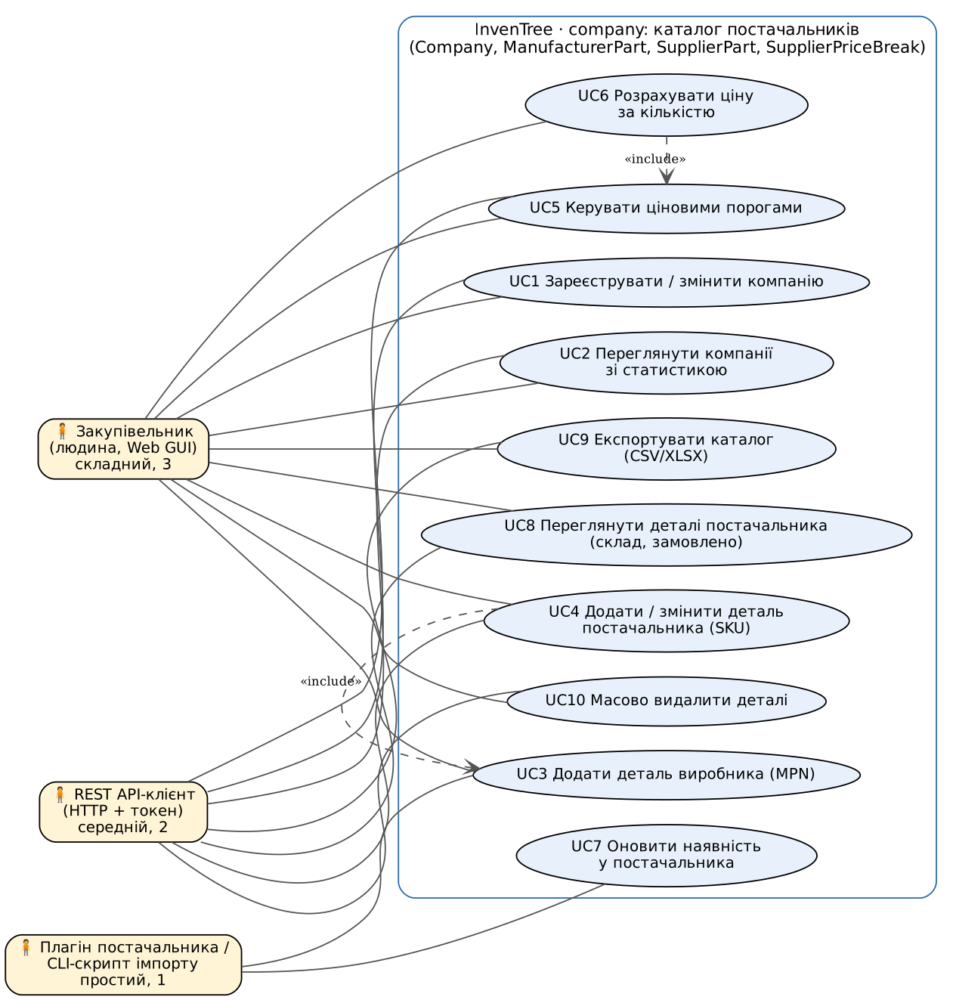

# Лабораторна робота №9
## Математичне моделювання SQALE, фінансова капіталізація технічного боргу та функціональне оцінювання розміру систем (FPA & UCP)

**Репозиторій:** Curs_Project, гілка `lab9-software-economics` (від `0835cdb`, кінець ЛР8)
**Інструменти:** SonarQube Cloud Web API, Python 3 (симулятор), Google Таблиці / LibreOffice (калькулятор `.xlsx`), Draw.io (`.drawio`), git

| Коміт | Що всередині |
|---|---|
| `f0ec11f` `feat(economics): SQALE financial simulator — Principal, Cost of Delay, NPV ledger, PASS` | `report.json`, `scripts/software_economics.py`, тести, `FINANCIAL_LEDGER.md` |
| `1f51ca6` `docs(sizing): FPA & UCP calculator, use case diagram, PF calibration …` | `fpa_ucp_calculator.xlsx`, Use Case діаграма |

Усі артефакти лежать у `last – копія/experiments/lab9/`, леджер — у корені проєкту `last – копія/FINANCIAL_LEDGER.md`.

---

## Завдання 1. Forensic-аудит SQALE-моделі

### 1.1 Картка об'єкта аудиту

| Поле | Значення |
|---|---|
| Проєкт | **InvenTree** — open-source система управління складом і запасами: деталі, склад, постачальники, закупівлі, продажі, виробництво (Django REST API + React UI) |
| Репозиторій | https://github.com/inventree/InvenTree |
| Дашборд SonarQube Cloud | https://sonarcloud.io/project/overview?id=inventree_InvenTree |
| Organization key | `inventree` |
| Project key | `inventree_InvenTree` |
| Проаналізована ревізія | `afc88f56e8f0` (аналіз Sonar від 2026-11-22 22:45 UTC) |
| Масштаб | **171 018 ncloc** (≥ 50 000 ✔): Python 70 163, TypeScript 90 405, інше 10 450; 1 125 файлів, 1 613 класів |

Чому саме InvenTree: це той самий домен, що й наш Curs_Project (оптовий склад: товари, постачальники, рух товару), тільки промислового масштабу. Тому порівняння «наш проєкт ↔ enterprise-проєкт» має сенс.

### 1.2 Протокол хмарного API-виклику

Пошук кандидатів (Python, > 50 000 ncloc):

```
GET https://sonarcloud.io/api/components/search_projects?filter=ncloc>50000 and languages=py&ps=100
```

Основний запит SQALE-метрик:

```bash
curl -s "https://sonarcloud.io/api/measures/component?component=inventree_InvenTree&metricKeys=sqale_index,ncloc,sqale_rating" \
  -o experiments/lab9/report.json
```

Сира відповідь сервера (`experiments/lab9/report.json`):

```json
{
  "component": {
    "id": "AY6bwFbHlFaVF3PgdjuC",
    "key": "inventree_InvenTree",
    "name": "InvenTree",
    "qualifier": "TRK",
    "measures": [
      { "metric": "ncloc",        "value": "171018" },
      { "metric": "sqale_index",  "value": "5026", "bestValue": false },
      { "metric": "sqale_rating", "value": "1.0",  "bestValue": true }
    ]
  }
}
```

Контрольний запит для верифікації (`experiments/lab9/extra.json`):

```bash
curl -s "https://sonarcloud.io/api/measures/component?component=inventree_InvenTree&metricKeys=sqale_debt_ratio,development_cost,ncloc_language_distribution,files,classes,functions"
```
→ `sqale_debt_ratio = 0.1`, `development_cost = 5130540`, `files = 1125`, `classes = 1613`, `functions = 9426`.

> `sqale_rating` API повертає числом: 1.0 = A, 2.0 = B, 3.0 = C, 4.0 = D, 5.0 = E.

### 1.3 Математична паспортизація боргу

**Переведення в людино-дні:**

$$\text{Борг}_{год} = \frac{5026}{60} = 83{,}77 \text{ люд.-год}, \qquad \text{Борг}_{днів} = \frac{83{,}77}{8} = 10{,}47 \text{ люд.-днів}$$

**Час написання системи з нуля (SQALE: 30 хв на рядок):**

$$T_{dev} = \frac{171\,018 \times 30}{60} = 85\,509 \text{ люд.-год}$$

**Індекс щільності технічного боргу:**

$$TDD = \frac{83{,}77}{85\,509} \times 100\% = 0{,}098\%$$

**Верифікація хмарних розрахунків:**
* `development_cost` з хмари = 5 130 540 хв = 171 018 × 30 — збігається з нашою формулою;
* `sqale_debt_ratio` з хмари = 0,1 % — це наш 0,098 %, округлений Sonar до десятої;
* TDD 0,098 % ≤ 5 % → **рейтинг A**; хмара повернула `sqale_rating = 1.0` = **A** → **збігається**.

### 1.4 SQALE Audit Ledger

| Масштаб (ncloc) | Обсяг боргу | Розрахунковий TDD | Рейтинг за TDD | Хмарний рейтинг (sqale_rating) |
|---:|---|---:|:---:|:---:|
| 171 018 | 5 026 хв = **83,77 люд.-год = 10,47 люд.-днів** | **0,098 %** | A (≤ 5 %) | **A** (1.0) ✔ |

**Експертний висновок:** InvenTree має дуже низьку щільність боргу. 10,5 людино-днів боргу на 171 тис. рядків — це менше 0,1 % вартості написання системи. Причини видно в самому репозиторії: pre-commit з ruff, CI-перевірки (`.github/workflows/qc_checks.yaml`), Codecov. Розбивка боргу по папках бекенду (запит `api/measures/component_tree`): усього ≈ 518 хв, найбільше в ядрі `InvenTree/` (139 хв) і `plugin/` (114 хв). Решта ≈ 4 500 хв припадає на частини поза цими папками (TypeScript-фронтенд, документація, службові скрипти). У модулі `company`, який аналізується в Завд.3, боргу **0 хв**.

---

## Завдання 2. Software Economics і Financial Quality Ledger

### 2.1 Формули

| Величина | Формула (в коді) |
|---|---|
| Повна вартість години | `loaded_rate = HOURLY_RATE × OVERLOAD_COEFF` |
| Тіло боргу (Principal) | `sqale_index / 60 × loaded_rate` |
| Вартість затримки (Cost of Delay), на місяць | `ncloc / 100 × 1 год × loaded_rate` |
| Коефіцієнт дисконтування | `1 / (1 + DISCOUNT_RATE)^t` |
| Кумулятивна NPV | `NPV_t = Σ_{k=1..t} CoD / (1 + r)^k − Principal` |
| Payback | перший `t`, для якого `NPV_t > 0` |
| Quality Gate | PASS, якщо payback ≤ 6 міс., інакше FAIL з архітектурним попередженням |

Параметри: `HOURLY_RATE = 40` ($/год, діапазон 35–50), `OVERLOAD_COEFF = 1.3`, `DISCOUNT_RATE = 0.01`.

**Економічний зміст Cost of Delay.** Це гроші, які компанія втрачає **щомісяця**, поки борг не прибрано: за правилом лабораторної це 1 інженерна година на кожні 100 рядків коду на боротьбу з регресійними багами. Після рефакторингу ці втрати зникають, тому CoD — це грошовий потік (прибуток) інвестиції в рефакторинг. Principal — разова інвестиція в момент t = 0.

### 2.2 Вихідний код симулятора (`scripts/software_economics.py`)

Скрипт нічого не «вшиває»: `ncloc`, `sqale_index`, `sqale_rating` і ключ проєкту читаються з JSON, ставки — зі змінних оточення. Він перевіряє діапазон ставки, наявність метрик і повертає exit-код (0 — PASS, 1 — FAIL, 2 — помилка вхідних даних), тому його можна вбудувати в CI як ворота якості. Покритий 11 тестами (`tests/test_software_economics.py`), серед них сценарії FAIL і окупності на 4-му місяці.

```python
"""ЛР9, Завд.2: Software Economics — капіталізація технічного боргу (SQALE -> $).

Вхід:
  * report.json — сира відповідь SonarQube Cloud `api/measures/component`
    (метрики sqale_index, ncloc, sqale_rating);
  * змінні оточення HOURLY_RATE, OVERLOAD_COEFF, DISCOUNT_RATE.

Розрахунок:
  Principal = sqale_index / 60 * HOURLY_RATE * OVERLOAD_COEFF            — тіло боргу, $
  CoD       = ncloc / 100 * 1 год * HOURLY_RATE * OVERLOAD_COEFF          — збитки за місяць, $
  NPV_t     = sum_{k=1..t} CoD / (1 + DISCOUNT_RATE)^k  -  Principal      — кумулятивна NPV

Вихід: FINANCIAL_LEDGER.md з таблицею грошових потоків, точкою окупності
і статусом воріт якості (PASS — NPV > 0 протягом HORIZON місяців, інакше FAIL).

Запуск:
  HOURLY_RATE=40 OVERLOAD_COEFF=1.3 DISCOUNT_RATE=0.01 \
    python scripts/software_economics.py experiments/lab9/report.json
"""
import argparse
import json
import os
import sys
from dataclasses import dataclass
from datetime import date
from pathlib import Path

HORIZON = 6                    # місяців після рефакторингу
LINES_PER_LOST_HOUR = 100      # 1 інженерна година втрат на 100 ncloc на місяць
MINUTES_PER_HOUR = 60
HOURS_PER_DAY = 8
WRITE_MINUTES_PER_LINE = 30    # SQALE: вартість написання 1 рядка з нуля
RATE_RANGE = (35.0, 50.0)      # допустима ставка за умовою ЛР
RATINGS = "ABCDE"
DEFAULT_OUT = Path(__file__).resolve().parents[1] / "FINANCIAL_LEDGER.md"


@dataclass(frozen=True)
class Baseline:
    key: str
    ncloc: int
    sqale_index: int        # хвилини
    sqale_rating: str       # A..E


@dataclass(frozen=True)
class Config:
    hourly_rate: float
    overload: float
    discount: float

    @property
    def loaded_rate(self):
        """Повна вартість інженерної години для компанії, $."""
        return self.hourly_rate * self.overload


@dataclass(frozen=True)
class Month:
    t: int
    factor: float           # 1 / (1 + r)^t
    cash_flow: float        # збережені збитки (CoD) за місяць
    present_value: float    # CoD * factor
    npv: float              # кумулятивна NPV


# ---------- вхідні дані ----------

def load_baseline(path):
    """Парсить сиру відповідь Sonar API: значення беруться з JSON, не з коду."""
    data = json.loads(Path(path).read_text(encoding="utf-8"))
    component = data["component"]
    values = {m["metric"]: m["value"] for m in component["measures"]}
    missing = {"ncloc", "sqale_index", "sqale_rating"} - values.keys()
    if missing:
        raise ValueError(f"У {path} немає метрик: {', '.join(sorted(missing))}")
    return Baseline(
        key=component["key"],
        ncloc=int(values["ncloc"]),
        sqale_index=int(values["sqale_index"]),
        sqale_rating=rating_letter(values["sqale_rating"]),
    )


def rating_letter(value):
    """Sonar віддає рейтинг числом 1.0..5.0 — переводимо у літеру A..E."""
    return RATINGS[int(float(value)) - 1]


def env_float(name, environ):
    raw = environ.get(name)
    if raw is None:
        raise ValueError(f"Не задано змінну оточення {name}")
    return float(raw)


def load_config(environ=None):
    environ = os.environ if environ is None else environ
    config = Config(
        hourly_rate=env_float("HOURLY_RATE", environ),
        overload=env_float("OVERLOAD_COEFF", environ),
        discount=env_float("DISCOUNT_RATE", environ),
    )
    low, high = RATE_RANGE
    if not low <= config.hourly_rate <= high:
        raise ValueError(f"HOURLY_RATE має бути в діапазоні ${low:.0f}-${high:.0f}")
    if config.overload < 1 or not 0 <= config.discount < 1:
        raise ValueError("OVERLOAD_COEFF має бути >= 1, DISCOUNT_RATE — у [0; 1)")
    return config


# ---------- SQALE і фінанси ----------

def debt_hours(baseline):
    return baseline.sqale_index / MINUTES_PER_HOUR


def tdd_percent(baseline):
    """Technical Debt Density = борг (год) / час написання з нуля (год) * 100."""
    build_hours = baseline.ncloc * WRITE_MINUTES_PER_LINE / MINUTES_PER_HOUR
    return debt_hours(baseline) / build_hours * 100


def principal(baseline, config):
    """Тіло боргу: вартість повного виправлення прямо зараз, $."""
    return debt_hours(baseline) * config.loaded_rate


def cost_of_delay(baseline, config):
    """Щомісячні збитки від бездіяльності (регресійні баги), $."""
    lost_hours = baseline.ncloc / LINES_PER_LOST_HOUR
    return lost_hours * config.loaded_rate


def simulate(baseline, config, horizon=HORIZON):
    """Цикл t = 1..horizon: дисконтований грошовий потік і кумулятивна NPV."""
    invest = principal(baseline, config)
    cash_flow = cost_of_delay(baseline, config)
    months, npv = [], -invest
    for t in range(1, horizon + 1):
        factor = 1 / (1 + config.discount) ** t
        present_value = cash_flow * factor
        npv += present_value
        months.append(Month(t, factor, cash_flow, present_value, npv))
    return months


def payback_month(months):
    """Перший місяць, на якому NPV_t > 0, або None."""
    for month in months:
        if month.npv > 0:
            return month.t
    return None


# ---------- леджер ----------

def money(value):
    return f"${value:,.2f}"


def ledger_rows(months):
    yield "| Місяць t | Коеф. дисконтування 1/(1+r)^t | Щомісячний прибуток (CoD), $ | Приведена вартість, $ | Кумулятивна NPV, $ |"
    yield "|---:|---:|---:|---:|---:|"
    for m in months:
        yield (f"| {m.t} | {m.factor:.4f} | {money(m.cash_flow)} | "
               f"{money(m.present_value)} | **{money(m.npv)}** |")


def verdict(payback, horizon):
    if payback is not None:
        return (f"Точка виходу в нуль (Payback Period): окупність настає на **{payback}-му** місяці.",
                "PASS")
    return (f"За {horizon} міс. NPV не виходить у плюс: тіло боргу перевищує дисконтовану економію. "
            "⚠ Архітектурне попередження: рефакторинг треба дробити на етапи або спершу "
            "знижувати борг у гарячих точках.", "FAIL")


def render_ledger(baseline, config, months, today=None):
    today = today or date.today()
    payback = payback_month(months)
    text, status = verdict(payback, len(months))
    lines = [
        "# SOFTWARE ECONOMICS & FINANCIAL QUALITY LEDGER",
        "",
        f"_Згенеровано `scripts/software_economics.py` {today.isoformat()}_",
        "",
        "## 1. Вхідні параметри аудиту (System Baseline)",
        "",
        "| Параметр | Значення |",
        "|---|---|",
        f"| Проєкт (SonarQube Cloud key) | `{baseline.key}` |",
        f"| Масштаб системи (NCLOC) | {baseline.ncloc:,} |",
        f"| Початковий технічний борг (SQALE Index) | {baseline.sqale_index:,} хв = "
        f"{debt_hours(baseline):,.2f} люд.-год = {debt_hours(baseline) / HOURS_PER_DAY:,.2f} люд.-днів |",
        f"| TDD (щільність боргу) | {tdd_percent(baseline):.3f} % |",
        f"| Хмарний рейтинг (sqale_rating) | {baseline.sqale_rating} |",
        f"| HOURLY_RATE / OVERLOAD_COEFF / DISCOUNT_RATE | ${config.hourly_rate:g} / {config.overload:g} / {config.discount:g} |",
        "",
        "## 2. Капіталізація інвестиційних маркерів",
        "",
        "| Маркер | Формула | Значення |",
        "|---|---|---:|",
        f"| Тіло боргу (Principal, вартість рефакторингу) | sqale_index / 60 × rate × overload | **{money(principal(baseline, config))}** |",
        f"| Щомісячні збитки від бездіяльності (Cost of Delay) | ncloc / 100 × 1 год × rate × overload | **{money(cost_of_delay(baseline, config))}** |",
        "",
        f"## 3. Динаміка окупності інвестицій ({len(months)} ітерацій)",
        "",
        *ledger_rows(months),
        "",
        "## 4. Фінальний інженерно-економічний вердикт",
        "",
        text,
        "",
        f"## 5. СТАТУС ВОРІТ ЯКОСТІ (Quality Gate): **{status}**",
        "",
    ]
    return "\n".join(lines), status


def main(argv=None):
    parser = argparse.ArgumentParser(description="SQALE -> Principal, Cost of Delay, NPV")
    parser.add_argument("report", help="report.json із SonarQube Cloud API")
    parser.add_argument("--out", default=str(DEFAULT_OUT), help="шлях до FINANCIAL_LEDGER.md")
    args = parser.parse_args(argv)
    try:
        baseline, config = load_baseline(args.report), load_config()
    except (OSError, ValueError, KeyError) as error:
        print(f"[economics] помилка вхідних даних: {error}", file=sys.stderr)
        return 2
    months = simulate(baseline, config)
    text, status = render_ledger(baseline, config, months)
    Path(args.out).write_text(text, encoding="utf-8")
    print(f"[economics] {baseline.key}: Principal {money(principal(baseline, config))}, "
          f"CoD {money(cost_of_delay(baseline, config))}/міс, NPV({len(months)}) {money(months[-1].npv)}")
    print(f"[economics] Quality Gate: {status} — леджер збережено у {args.out}")
    return 0 if status == "PASS" else 1


if __name__ == "__main__":
    sys.exit(main())
```

### 2.3 Консольний запуск

```bash
cd "last – копія"
HOURLY_RATE=40 OVERLOAD_COEFF=1.3 DISCOUNT_RATE=0.01 \
  python scripts/software_economics.py experiments/lab9/report.json
```

```
[economics] inventree_InvenTree: Principal $4,355.87, CoD $88,929.36/міс, NPV(6) $511,032.15
[economics] Quality Gate: PASS — леджер збережено у …/last – копія/FINANCIAL_LEDGER.md
```

> 📸 **Скріншот:** вставте сюди знімок свого терміналу з цим запуском.

### 2.4 Згенерований артефакт `FINANCIAL_LEDGER.md`

> ## SOFTWARE ECONOMICS & FINANCIAL QUALITY LEDGER
>
> _Згенеровано `scripts/software_economics.py` 2026-11-22_
>
> ### 1. Вхідні параметри аудиту (System Baseline)
>
> | Параметр | Значення |
> |---|---|
> | Проєкт (SonarQube Cloud key) | `inventree_InvenTree` |
> | Масштаб системи (NCLOC) | 171,018 |
> | Початковий технічний борг (SQALE Index) | 5,026 хв = 83.77 люд.-год = 10.47 люд.-днів |
> | TDD (щільність боргу) | 0.098 % |
> | Хмарний рейтинг (sqale_rating) | A |
> | HOURLY_RATE / OVERLOAD_COEFF / DISCOUNT_RATE | $40 / 1.3 / 0.01 |
>
> ### 2. Капіталізація інвестиційних маркерів
>
> | Маркер | Формула | Значення |
> |---|---|---:|
> | Тіло боргу (Principal, вартість рефакторингу) | sqale_index / 60 × rate × overload | **$4,355.87** |
> | Щомісячні збитки від бездіяльності (Cost of Delay) | ncloc / 100 × 1 год × rate × overload | **$88,929.36** |
>
> ### 3. Динаміка окупності інвестицій (6 ітерацій)
>
> | Місяць t | Коеф. дисконтування 1/(1+r)^t | Щомісячний прибуток (CoD), $ | Приведена вартість, $ | Кумулятивна NPV, $ |
> |---:|---:|---:|---:|---:|
> | 1 | 0.9901 | $88,929.36 | $88,048.87 | **$83,693.00** |
> | 2 | 0.9803 | $88,929.36 | $87,177.10 | **$170,870.10** |
> | 3 | 0.9706 | $88,929.36 | $86,313.96 | **$257,184.07** |
> | 4 | 0.9610 | $88,929.36 | $85,459.37 | **$342,643.43** |
> | 5 | 0.9515 | $88,929.36 | $84,613.23 | **$427,256.67** |
> | 6 | 0.9420 | $88,929.36 | $83,775.48 | **$511,032.15** |
>
> ### 4. Фінальний інженерно-економічний вердикт
>
> Точка виходу в нуль (Payback Period): окупність настає на **1-му** місяці.
>
> ### 5. СТАТУС ВОРІТ ЯКОСТІ (Quality Gate): **PASS**

### 2.5 Аналітичний висновок щодо Software Economics

1. **Формули показують, від чого залежить окупність.** Principal залежить від `sqale_index`, CoD — лише від `ncloc`. Payback за 6 місяців настає тоді, коли
   $$\frac{sqale\_index}{60} < \frac{ncloc}{100}\cdot\sum_{k=1}^{6}\frac{1}{1{,}01^k} = \frac{ncloc}{100}\cdot 5{,}795,$$
   тобто коли **TDD < 11,6 %**. Отже, проєкти з рейтингом A і B завжди проходять ворота (PASS), а з рейтингом C — лише на межі. D і E за пів року не окупаються (FAIL): тіло боргу більше за півроку економії. Тест `test_fail_when_debt_too_large` (10 000 рядків, 1 000 год боргу) показує саме такий FAIL.
2. **Масштаб працює на користь рефакторингу.** Чим більше `ncloc`, тим більший щомісячний CoD. Тому для великої системи з помірним боргом рефакторинг окуповується майже відразу: в InvenTree тіло боргу $4,4 тис. проти $88,9 тис. збитків на місяць, payback на 1-му місяці.
3. **Борг росте як відсоток.** Кожен місяць затримки — це ще один CoD, а дисконтування (1 %/міс) майже не зменшує цінність майбутньої економії на горизонті 6 місяців (коефіцієнт 0,94). Відкладати рефакторинг економічно невигідно.
4. **Обмеження моделі.** Правило «1 год на 100 рядків» не залежить від реального боргу, тому для чистого проєкту (TDD 0,1 %) CoD сильно завищений. На практиці CoD варто брати з реальних даних: часу на регресійні баги з трекера задач.

---

## Завдання 3. Функціональне вимірювання розміру (FPA & UCP)

**Обраний підмодуль:** `src/backend/InvenTree/company` — **каталог постачальників** InvenTree (ревізія `afc88f5`, 1 963 ncloc за Sonar, борг 0 хв). Ізольований набір із 4 пов'язаних класів:
`Company` → `ManufacturerPart` → `SupplierPart` → `SupplierPriceBreak`.

Повний калькулятор з формулами: **`experiments/lab9/fpa_ucp_calculator.xlsx`** (аркуші SQALE, NPV, Ваги IFPUG, FPA, UCP, Калібрування). Його можна імпортувати в Google Таблиці: File → Import.

### 3.1 Специфікація реверс-інжинірингу

**Сутності ORM (`company/models.py`) — джерело для ДАНИХ:**

| Клас | Таблиця БД | Поля (DET) |
|---|---|---|
| `Company` | `company_company` | name, description, website, phone, email, contact, link, active, is_customer, is_supplier, is_manufacturer, is_internal, currency, tax_id + image, notes, metadata, tags |
| `ManufacturerPart` | `company_manufacturerpart` | part → Part, manufacturer → Company, MPN, link, description + metadata, notes, tags, barcode |
| `SupplierPart` | `part_supplierpart` | part → Part, supplier → Company, SKU, active, primary, manufacturer_part → ManufacturerPart, link, description, note, base_cost, packaging, pack_quantity, pack_quantity_native, multiple, available, availability_updated + metadata, notes, tags, barcode |
| `SupplierPriceBreak` | `part_supplierpricebreak` | part → SupplierPart, quantity, price, price_currency, updated (`unique_together = part, quantity`) |

Зовнішні дані, які модуль **лише читає**: `part.Part` (FK), `order.PurchaseOrderLineItem` (`on_order()`), `stock.StockItem` (`annotate_total_stock`), курси валют (`common.currency`, `convert_to`).

**API-ендпоінти (`company/api.py`) — джерело для ТРАНЗАКЦІЙ:**

| Маршрут | View | Методи |
|---|---|---|
| `/api/company/` | `CompanyList(ListCreateAPI, DataExportViewMixin)` | GET (фільтри, статистика, експорт), POST |
| `/api/company/<pk>/` | `CompanyDetail(RetrieveUpdateDestroyAPI)` | GET, PUT/PATCH, DELETE |
| `/api/company/part/manufacturer/` | `ManufacturerPartList(ListCreateDestroyAPIView, DataExportViewMixin)` | GET, POST, DELETE (масово), експорт |
| `/api/company/part/manufacturer/<pk>/` | `ManufacturerPartDetail` | GET, PUT/PATCH, DELETE |
| `/api/company/part/` | `SupplierPartList(ListCreateDestroyAPIView, DataExportViewMixin)` | GET (in_stock, on_order), POST, DELETE (масово), експорт |
| `/api/company/part/<pk>/` | `SupplierPartDetail` | GET, PUT/PATCH, DELETE |
| `/api/company/price-break/` | `SupplierPriceBreakList(ListCreateAPI, DataExportViewMixin)` | GET, POST, експорт |
| `/api/company/price-break/<pk>/` | `SupplierPriceBreakDetail` | GET, PUT/PATCH, DELETE |

**Сигнатури доменних методів (логіка Use Cases):**

```python
ManufacturerPart.create(cls, part, manufacturer, mpn, description, link=None)   # знайти або створити
SupplierPart.clean(self)                         # пакування, одиниці виміру, узгодженість з ManufacturerPart
SupplierPart.save(self, *args, **kwargs)         # прив'язка MPN, validate_unique, автоматичний primary
SupplierPart.update_available_quantity(self, quantity)
SupplierPart.add_price_break(self, quantity, price) -> None
SupplierPart.get_price = common.currency.get_price(instance, quantity, moq=True, multiples=True, currency=None)
SupplierPart.on_order(self)                      # замовлено мінус отримано
CompanySerializer.annotate_queryset(queryset)    # parts_supplied, parts_manufactured
SupplierPartSerializer.annotate_queryset(queryset)  # in_stock, on_order
```

**Актори і Use Cases — UML-діаграма** (`experiments/lab9/use_case.drawio` відкривається в Draw.io; PNG нижче):



### 3.2 FPA Калькулятор (IFPUG Ledger)

Ваги IFPUG: ILF 7/10/15, EIF 5/7/10, EI 3/4/6, EO 4/5/7, EQ 3/4/6 (простий/середній/складний). Складність визначається за матрицями RET/FTR × DET (формули в аркуші `FPA`).

| Тип | Елемент | RET/FTR | DET | Склад. | FP |
|---|---|:-:|:-:|:-:|:-:|
| ILF | Company | 1 | 18 | L | 7 |
| ILF | ManufacturerPart | 1 | 9 | L | 7 |
| ILF | SupplierPart + SupplierPriceBreak (2 RET) | 2 | 24 | A | 10 |
| EIF | part.Part | 1 | 5 | L | 5 |
| EIF | order.PurchaseOrderLineItem | 1 | 3 | L | 5 |
| EIF | stock.StockItem | 1 | 2 | L | 5 |
| EIF | Курси валют | 1 | 3 | L | 5 |
| EI | Створити / змінити компанію | 1 | 18 | A | 4 + 4 |
| EI | Видалити компанію | 1 | 1 | L | 3 |
| EI | Створити / змінити деталь виробника | 3 | 9 | H | 6 + 6 |
| EI | Видалити / масово видалити деталь виробника | 1 | 1–2 | L | 3 + 3 |
| EI | Створити / змінити деталь постачальника | 4 | 24 | H | 6 + 6 |
| EI | Видалити / масово видалити деталь постачальника | 1 | 1–2 | L | 3 + 3 |
| EI | Створити / змінити ціновий поріг | 2 | 5 | A | 4 + 4 |
| EI | Видалити ціновий поріг | 1 | 1 | L | 3 |
| EO | Список / картка компаній зі статистикою (parts_supplied, parts_manufactured) | 3 | 20 | H | 7 + 7 |
| EO | Список / картка деталей постачальника (in_stock, on_order) | 6 | 27 | H | 7 + 7 |
| EO | Експорт компаній | 1 | 18 | L | 4 |
| EO | Експорт деталей виробника | 3 | 12 | A | 5 |
| EO | Експорт деталей постачальника | 4 | 27 | H | 7 |
| EO | Експорт цінових порогів | 2 | 7 | A | 5 |
| EQ | Список / картка деталей виробника | 3 | 12 | A | 4 + 4 |
| EQ | Список / картка цінових порогів | 2 | 7 | A | 4 + 4 |

| Категорія | Кількість | FP |
|---|:-:|:-:|
| ILF | 3 | 24 |
| EIF | 4 | 20 |
| EI | 14 | 58 |
| EO | 8 | 49 |
| EQ | 4 | 16 |
| **UFP** | **33** | **167** |
| VAF | — | 1,0 |
| **FP** | | **167** |

Чому GET-запити компаній і деталей постачальника віднесено до **EO**, а не EQ: вони повертають **похідні дані**, обчислені в момент запиту. Це кількість деталей (`SubqueryCount`), залишок на складі та кількість у відкритих замовленнях. За IFPUG будь-яка транзакція з обчисленням — це EO. Деталі виробника і цінові пороги віддаються без перетворень, тому це EQ.

### 3.3 UCP Матриця Карнера

**Актори (UAW):**

| Актор | Канал | Тип | Вага |
|---|---|---|:-:|
| Закупівельник / адміністратор складу | людина через Web GUI | Складний | 3 |
| REST API-клієнт | HTTP + токен | Середній | 2 |
| Плагін постачальника / CLI-імпорт | Python API (`update_available_quantity`, `ManufacturerPart.create`) | Простий | 1 |
| **UAW** | | | **6** |

**Use Cases (UUCW).** Транзакції — це кроки логіки, які видно в коді методів:

| Use Case | Кроки в коді | Транз. | Вага |
|---|---|:-:|:-:|
| UC1 Зареєструвати / змінити компанію | валідація → перевірка валюти → save → аудит | 4 | 10 |
| UC2 Переглянути компанії зі статистикою | фільтр → 2 анотації → сортування → пагінація | 5 | 10 |
| UC3 Додати деталь виробника | пошук існуючої → створення → save | 3 | 5 |
| UC4 Додати / змінити деталь постачальника | 7 кроків `clean()` + 5 кроків `save()` | 12 | 15 |
| UC5 Керувати ціновими порогами | перевірка дубля → створення → unique_together | 3 | 5 |
| UC6 Розрахувати ціну за кількістю | 9 кроків `get_price()` (кратність, валюта, вибір порогу, fallback, base_cost) | 9 | 15 |
| UC7 Оновити наявність у постачальника | available → timestamp → save | 3 | 5 |
| UC8 Переглянути деталі постачальника | фільтр → in_stock → on_order → output options → сортування → пагінація | 6 | 10 |
| UC9 Експортувати каталог | плагін → фільтри → серіалізація → файл → віддача | 5 | 10 |
| UC10 Масово видалити деталі | розбір → перевірка → видалення | 3 | 5 |
| **UUCW** | | | **90** |

$$UUCP = UAW + UUCW = 6 + 90 = 96$$
$$UCP = UUCP \times TCF \times ECF = 96 \times 1{,}0 \times 1{,}0 = \mathbf{96}$$

### 3.4 Зворотне калібрування продуктивності команди

**Трудовитрати з Git.** Взяли історію файлів модуля за обома шляхами, бо модуль переносили (`InvenTree/company/` → `src/backend/InvenTree/company/`):

```bash
git log --no-merges --format='%at|%aN' -- \
  src/backend/InvenTree/company/{models,api,serializers,filters}.py \
  InvenTree/company/{models,api,serializers,filters}.py
```

Результат: **344 коміти, 14 авторів, 2018-04-19 … 2026-11-22**. Основні автори: Oliver Walters (231 коміт), Matthias Mair (58), eeintech (29).

Години рахували сесійним алгоритмом git-hours. Коміти одного автора з паузою менше 2 год вважаються однією робочою сесією і рахуються за фактичним часом між ними; до кожної сесії додається 2 год на роботу до першого коміту.

| Показник | Значення |
|---|---:|
| Git-години всього модуля | 588,3 люд.-год |
| Частка 4 обраних класів у коді модуля (за рядками класів у models/api/serializers/filters) | 84,9 % |
| **Трудовитрати на підсистему** | **499,5 люд.-год** |
| Розмір | 96 UCP / 167 FP |
| **PF = 499,5 / 96** | **5,20 люд.-год на 1 UCP** |
| PF на функціональну точку | 2,99 люд.-год на 1 FP |
| Еталон Карнера | 20 люд.-год на 1 UCP |

**Інтерпретація.** PF = 5,2 год/UCP приблизно в 4 рази менше за еталон Карнера. Тут дві причини. Команда InvenTree справді продуктивна: зріла Django-архітектура, генеричні міксини (`DataExportViewMixin`, `ListCreateDestroyAPIView`) дають CRUD «майже безкоштовно». Крім того, git-години — це **нижня межа**: вони не враховують аналіз, рев'ю, обговорення в issues і роботу між комітами. Тому для бюджетування варто брати діапазон **5,2 … 20 год/UCP**, а відкалібрований PF використовувати як оптимістичну межу.

### 3.5 Як PF допомагає оцінювати Change Requests

Відкалібрований PF перетворює **специфікацію** на **бюджет ще до першого рядка коду**:

1. Аналітик описує CR як use case і рахує транзакції за сценарієм.
2. ΔUCP × PF = трудовитрати; трудовитрати × `HOURLY_RATE × OVERLOAD_COEFF` = бюджет.

Приклад (аркуш «Калібрування»). CR «Імпорт прайс-листа постачальника»: 6 транзакцій → середній UC = 10 UCP.
* Оцінка: 10 × 5,20 = **52 люд.-год** → 52 × $52 = **$2 705**.
* Песимістична межа за Карнером: 10 × 20 × $52 = $10 400.

Що це дає компанії:
* **Ціна CR обґрунтована цифрами**, а не «на око». Замовник бачить, з чого складається сума: кількість транзакцій → UCP → години.
* **Ризики керовані.** Розрив між оптимістичним PF і еталоном — це буфер на невизначеність. Його можна закласти в договір як діапазон.
* **Модель самокалібрується.** Після кожного CR фактичні години з git додаються в вибірку і PF уточнюється. FPA (167 FP) використовується як незалежна перевірка: розмір, рахований від даних, не залежить від того, як ми порізали use cases.

**Різниця FPA і UCP.** FPA міряє розмір **з боку даних і транзакцій** (таблиці, вхідні/вихідні потоки, запити) і не залежить ні від мови, ні від ООП. UCP міряє розмір **з боку поведінки** (хто користується системою і скільки кроків у сценаріях) і зручніший на ранніх етапах, коли є лише use case діаграма. Для одного модуля вони дали 167 FP і 96 UCP, тобто приблизно 1,7 FP на 1 UCP.
